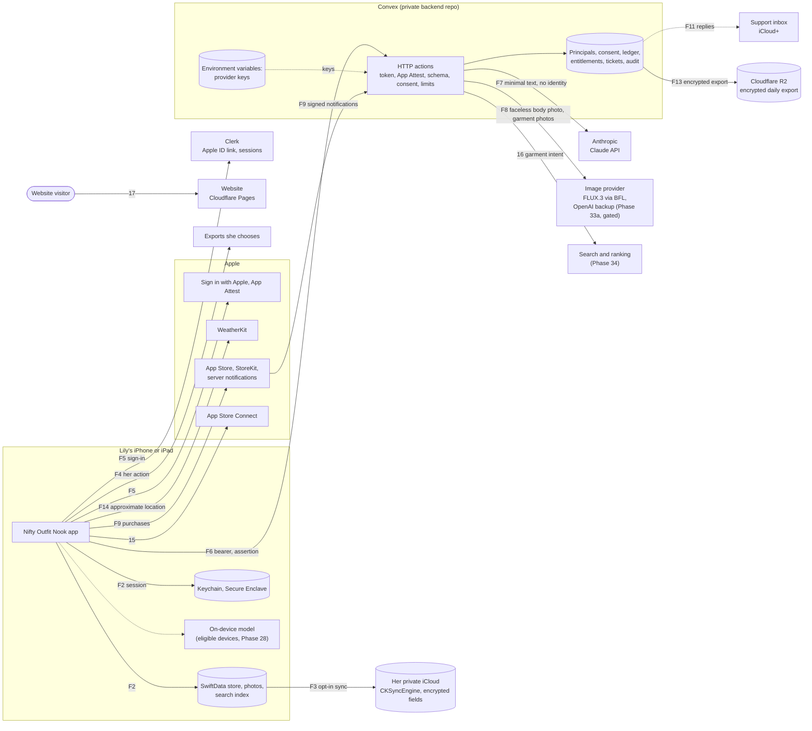

# Data classification and data map

Phase 0c wrote the first version on 13 October 2026. **Phase 19a updated it on 18 October 2026** for the stack Jose chose that day ([STACK.md](STACK.md)): SwiftData with `CKSyncEngine` on the device, Clerk for sign-in, Convex as the backend, the Claude API and the try-on image provider called only from Convex, and Cloudflare R2 for backups. **Updated again on 19 October 2026** for Jose's try-on decision: FLUX.3, with her face masked on the phone so only a faceless body photo on a plain studio backdrop and garment photos go out, and, as first decided, real photos only under no-training terms (see [THREAT_MODEL.md](THREAT_MODEL.md), D1). Later that day Jose approved BFL's standard API for those faceless photos, accepting that BFL may keep them and train on them, on condition that the app discloses it plainly. **Phase 20b (20 October 2026)** filled in the on-device backup, export and iCloud rows from the app repo's `docs/decisions/0004-backup-and-recovery.md` (proposed, waiting on Jose). **Phase 21b (20 October 2026)** built export and restore and updated those rows to match (iCloud is still not built). **Phase 22a (20 October 2026)** brought real photos in from the camera and the system photo picker, kept without their metadata, and updated the device, try-on photo, garment photo, garment-understanding and F1 rows. **Phase 22c (21 October 2026)** added the system Paste button to Add a piece as one more intake source with the same handling as the picker (no new data, no permission, no new storage). **Phase 24a (21 October 2026)** built the gateway and sign-in against mocks (the fake sign-in and an in-process fake backend send nothing anywhere) and filled in the identity, session and audit rows from what the backend now stores. **Phase 24b (21 October 2026)** built limits and cost protection against mocks and filled in the usage ledger, App Attest and spending-control rows from what the backend now stores (no new personal data; no provider is called). **Phase 33a (22 October 2026)** built try-on pictures with the face kept on the phone: the try-on job, the upload kept on the phone for "See what was sent", the try-on consent, the BFL processor and F8 now say what is built (BFL is called only once Jose sets its key; a fake answers until then). This is the data map required by [SECURITY_STANDARD.md](SECURITY_STANDARD.md) section 1. It covers the whole system as planned in [the master PRD](Nifty_Outfit_Nook_PRD_v2.md) and [the room-direction amendment](PRD_Amendment_Room_Direction.md). The threat model, with a flow-by-flow view (F1 to F14) and the decisions Jose needs to make, is in [THREAT_MODEL.md](THREAT_MODEL.md). The accounts are in [ACCOUNT_INVENTORY.md](ACCOUNT_INVENTORY.md).

**Phase 21a (20 October 2026) built real storage on the device; nothing else in Stage B is built or signed up for yet.** Her data now lives in a SwiftData store on the iPhone (`Application Support/Store/Nook.store`, Data Protection `complete`, one record per value as JSON): every Release build, and a Debug build on the empty closet, keep everything she adds or changes, her whole profile (fit and measurements included), drafts, the unsent feedback note, the onboarding state and the tours seen. The first launch of a 21a build moves Stage A's `UserDefaults` suite (Phase 17's flags, the name on the sign and three Style Me settings) into the store and empties the suite. The debug sample closet still lives in memory and keeps only the name and the Style Me settings, now in the store. There's still no network, account or sync. See the app repo's `docs/models.md` (Real storage) and `docs/onboarding.md`. Phase 20a's note on Stage A: until 21a, everything but those flags, the name and the settings was in memory only. Every phase that adds or changes a data flow updates this map (Definition of done, item 6).

Retention values come from PRD section 15.4 unless noted. They are product requirements still to be checked against provider terms and the law (Phase 19b and the legal review in 35a). Provider terms are stated only where they were checked on the provider's official page on 18 October 2026, with the URL in [Processors](#processors). Everything else says **to verify in 19b**.

## Tiers

The tiers are the standard's: **Sensitive**, **Personal**, **Account and billing**, **Secrets** and **Public**. Two rules used below:

- When one record or request mixes tiers, it takes the highest one. A styling request that carries a measurement is Sensitive, even though most of it is wardrobe text.
- Prompts, fit rules, styling rules and model configuration aren't user data and have no tier of their own. They are confidential business logic: private backend repo and Convex only (standard sections 3 and 7), never in the app repo or the app binary.

## Where data can live

| Place | What it is | Who can read it |
|---|---|---|
| **Device** | The app's container on Lily's iPhone or iPad: SwiftData store (with the `CKSyncEngine` state as a row), image files, safety copies in `Application Support/Store/Recovery` (migration) and `Application Support/Store/RestoreSafetyCopy` (restore), 7 days at most, photo files in `Application Support/Photos` (since 22a: garment photos and the try-on photo, one cleaned JPEG per photo named by a UUID, Data Protection `complete`, in device backups like the store; since 22b also cutouts and stored try-on pictures, and a new file is only written when 50 MB stays free), thumbnails in `Library/Caches/Thumbnails` (22b: 512 and 1,024 pixels, Data Protection `complete`, at most 200 MB, made again when missing), search index, caches, Keychain (Clerk session, a device-only marker that tells a restored backup apart), Secure Enclave (App Attest key). Device backups (iCloud Backup or a computer) copy the store and images; safety copies, export and restore staging, thumbnails, the index and caches are left out. | Lily. Anyone holding her unlocked phone. |
| **iCloud (private)** | Optional sync through `CKSyncEngine` into her own private CloudKit database, container `iCloud.com.jsayram.niftyoutfitnook`. Off unless she turns it on, and not offered until Phase 21b's tests pass. Three custom zones (20b): `Closet` (pieces, looks, suitcases, try-on pictures, profile without body data, drafts, images), `Me` (measurements, weight, fit notes, pieces that fit well, try-on photo; **not synced until Jose decides 5.1.3(ii)**), and `Control` (one content-free generation record). Every record keeps its content in one encrypted `payload` field with an encrypted `payloadVersion` and `tombstone`; images are separate records with a `CKAsset`, which CloudKit always encrypts. No `CKRecord.Reference` and no other plain fields. | Lily, on her own devices. Without Advanced Data Protection Apple holds the keys and could decrypt everything the app puts there (accepted risk D8(a)); with ADP, encrypted fields and assets are end-to-end encrypted (Apple's `encryptedValues` documentation, checked 20 October 2026). Either way Apple sees record types, counts, sizes and dates. Not readable by Jose or Convex. |
| **Convex** | The backend: HTTP actions as the gateway, a database for principals, consent, ledger, entitlements, support tickets and the audit log, environment variables for keys, and short-lived image staging in Phase 33a. Separate dev and production deployments. No closet replica. | Jose through the Convex dashboard and deploy keys; the daily backup job; Convex as processor. Agents only on the dev deployment (THREAT_MODEL R13). |
| **Clerk** | Sign-in provider. Holds the Clerk user (her Apple user ID, optional email and name) and her sessions. Separate dev and production instances. | Jose through the Clerk dashboard; Clerk as processor. |
| **Anthropic** | Claude API, called only from Convex, for the stylist, swaps and Ask stylist. | Anthropic, transiently and under its retention terms. |
| **Image provider** | FLUX.3 through Black Forest Labs' standard API, for try-on pictures (Phase 33a, gated), called only from Convex. OpenAI's image API is the backup. WaveSpeed is used for test and demo images only, never real photos. | Black Forest Labs, which per its standard terms may keep inputs and outputs permanently and train on them (accepted by Jose, D1, disclosed in the app). |
| **Cloudflare R2** | Private bucket holding the daily encrypted Convex export, 30 days of copies. | Only whoever holds the offline private key can decrypt. Jose; Cloudflare stores the ciphertext. |
| **Apple services** | Sign in with Apple, App Attest, App Store and StoreKit, App Store Server Notifications, App Store Connect (TestFlight, tester feedback, crash reports), WeatherKit. | Apple. Jose sees what App Store Connect shows him. |
| **Support inbox** | The project address on iCloud+ with a custom domain, used for replies. | Jose. Apple operates the mailbox. |
| **Website** | https://niftyoutfitnook.pages.dev/ on Cloudflare Pages. Static, first-party script only, no analytics or forms, strict CSP. | Anyone. Cloudflare sees visitor requests. |
| **Planning repo and review site** | This public repo, and the mockup review site on here.now. | Anyone. See "Data that exists today". |

## Classification

Columns: **Lives** names every place a copy can be, including providers that see it only while processing a request. **What deletes it** names the action or job that removes each copy. Phases are the ones that build the controls; see [SWIFT_BUILD_PLAN.md](SWIFT_BUILD_PLAN.md).

### Lily's body, likeness and health-adjacent data

| Data | Tier | Lives | Retention | What deletes it | Who can read it | Phases |
|---|---|---|---|---|---|---|
| Height, body measurements (waist, bust, inseam and so on), optional weight. Each keeps the unit it was typed in; Fit and measurements and its sheets are hidden in the app switcher, and the values never print in logs (14a) | Sensitive | Device; optional iCloud in the `Me` zone (encrypted payload), only if Jose allows it under App Review 5.1.3(ii), off until then (20b); the encrypted export; Anthropic transiently, only the minimum relevant fact inside a consented styling request. Never to the image provider, Clerk, Convex storage, logs or public search | Until she edits or deletes it. Anthropic: within 30 days, up to 2 years if flagged | Her edit or delete; Delete my data (device and iCloud zone); Anthropic's own deletion | Lily; Anthropic while processing | 14a, 20b, 21a, 24a, 27a |
| Fit feedback about her body ("too long in the leg"), Fit profile notes, reference garments | Sensitive | Same as measurements | Until deleted | Same as measurements | Lily; Anthropic while processing | 14a, 27a |
| Today's comfort (request-scoped, LR-18) | Sensitive (health-adjacent) | Device for the current request; kept with a look only if she chooses; Anthropic transiently, neutral clothing wording only. Raw symptoms or cycle text never accepted | Today only, unless saved with a look | End of day; deleting the look; Delete my data | Lily; Anthropic while processing | 10a, 27a |
| Try-on reference photo of Lily (Profile, "Your try-on photo"). Stage A stored only an example stand-in. Since 22a, her own photo from the system photo picker (no permission), kept as a copy made from the pixels alone: no location, camera details, time or captions. The bytes she picked are never written. Changing or removing it deletes the old file at once; the debug sample closet keeps the example | Sensitive (her likeness) | Device; optional iCloud in the `Me` zone (`CKAsset`), with the same 5.1.3(ii) hold as measurements; the encrypted export. **The full photo never leaves the device** except into her own iCloud and her own export. From Phase 33a only, for each try-on job the phone makes a faceless copy (Apple Vision fills her head and hair with flat grey and replaces the room with a plain studio backdrop; no face found or mask not confirmed means no job) and that copy goes through Convex staging to Black Forest Labs, after its own named-recipient permission and the plain disclosure in the consent screen, which "See what was sent" matches exactly | Until she deletes it. Convex staging: the sealed inputs are deleted when the provider call ends, and nothing stays longer than 30 minutes (the consent says so in plain words, corrected 22 October 2026). BFL: **may keep the faceless copy permanently and train on it** (accepted by Jose, D1, disclosed) | Her delete; Delete my data; Convex staging cleanup job. We can't delete what BFL holds | Lily; BFL (faceless copy only) | 14a (mock), 22a, 33a |
| Try-on pictures (pictures of her wearing a look). Each record keeps its look's ID and the look as it was; Stage A's are drawn on the phone with no person in them, and hidden in the app switcher | Sensitive | Device; optional iCloud. From Phase 33a, BFL returns the dressed faceless body, Convex holds it sealed for at most 30 minutes (2 minutes after the phone first receives it) and then deletes it, and the phone blends her real head back in and stores the finished picture on the device and her iCloud if on | Until she deletes them; no automatic expiry, and deleting the look keeps them. Since 21b they go when a piece they show is deleted for good (Delete now or the 30-day purge, Jose 20 October 2026), and a restore leaves those out. BFL: **may keep the dressed faceless output permanently and train on it** (accepted, disclosed) | Her delete (since 22b a stored picture's file and thumbnails go once Delete picture's Undo has gone, and at the next launch at the latest); deleting a piece they show for good (file, thumbnails and the restore's safety copy too, 22b); Delete my data; Convex staging cleanup. We can't delete what BFL holds | Lily; BFL | 12b (simulated), 21b, 22b, 33a |
| Any garment or wishlist photo that shows a person (mirror selfie, worn shot) | Sensitive | Device; optional iCloud. Never on the text route; only a separately permissioned photo route after moderation | Until deleted | Her delete; Recently deleted purge; Delete my data | Lily | 22a, 22b, 33 |
| Device location (optional "Use my location") | Sensitive | Device only, while the app is open. Built in 29: approximate only (reduced accuracy, While Using, never Always, never precise), rounded to 0.1 degree (about 11 km) the moment it arrives (`CoarseCoordinate`), held in memory for up to an hour, never written to disk or logs. Apple WeatherKit receives the rounded coordinate. It never goes to Convex or an AI provider | Memory only, up to 1 hour | Nothing to delete; gone when the app closes | Lily; Apple | 29 |
| Weather choices (Live weather on or off, "Use my location" on or off, the city she picked: its name and its rounded coordinate) | Personal | Device: a `UserDefaults` suite only this app can read (`com.jsayram.niftyoutfitnook.weather`), in device backups like any app setting. Not in the backup export. Never sent to Convex or an AI provider | Until she changes it | Turn the switch off or remove the city; Delete my data erases it with the profile | Lily | 29 |
| City search text (what she types to find a city) | Personal | Sent to Apple Maps (MapKit geocoding) from the device, only while the city sheet is open. The result is a name and a point, which is rounded on arrival. Nothing is stored from the search | Not stored by us | Nothing to delete | Apple | 29 |

### Her closet and how she uses it

None of these go to Convex, Clerk or R2. The backend holds no copy of the closet.

| Data | Tier | Lives | Retention | What deletes it | Who can read it | Phases |
|---|---|---|---|---|---|---|
| Garment photos (originals, cutouts, thumbnails), EXIF and GPS stripped at intake. Since 22a only the original is kept: from the camera, the system picker or the system Paste button (21 October 2026: the same intake, no permission, nothing read unless she taps Paste), cleaned to an upright JPEG of at most 4,096 pixels with no metadata, in `Application Support/Photos`. A photo replaced before saving, a discarded new piece's photo and a discarded draft's photo are deleted at once. Since 22b a cutout is its own PNG file next to its original (storage built; making cutouts of her photos waits for the go/no-go), thumbnails are kept in `Library/Caches/Thumbnails` (Personal, protected, never backed up, removed with their image), a piece deleted for good takes its photo, cutout and thumbnails at once, and each launch removes any file no record points to (such as the photo a saved edit replaced) | Personal, stored with Sensitive file protection because a photo can show a person or a room | Device; optional iCloud. Not on the text route (Convex rejects images). From Phase 33a, selected garment photos go to BFL with a try-on job | Until deleted; Recently deleted up to 30 days. BFL: **may keep them permanently and train on them** (accepted by Jose, D1, disclosed) | Her delete, then the 30-day purge or Delete permanently now; Delete my data; staging cleanup. We can't delete what BFL holds | Lily; BFL | 7b, 8a, 21a, 22a, 22b, 33a |
| Garment details: category and its type (Cardigan, Loafers; 21c), colour, brand, size label, fabric, personal names and other names (aliases; 21c: up to 10, inside the garment's record, payload version 2, carried in exports; since 21 October 2026 also added by Remember this name, only the words she confirms on that piece, never the search itself), keywords | Personal | Device; optional iCloud; encrypted export; search index; Anthropic transiently, minimal descriptors inside a consented request | Until edited or deleted | Her edit or delete (removing an other name removes it from the record at once); index rebuild; Delete my data | Lily; Anthropic while processing | 3, 7a, 7b, 21a, 21c, 27a |
| Free-text notes (garment notes, Style Me notes, Ask stylist messages) | Sensitive (she can type anything) | Device; optional iCloud; Anthropic transiently, only the text she sends with a consented request, up to 2,000 characters | Notes until deleted. Raw chat or request text not kept as history | Her delete; Delete my data | Lily; Anthropic while processing | 7b, 10a, 27a |
| Saved looks, results, version kind (Simple, Dressed up, Something new), look names, when each was saved. Since 21c, Saved Looks' All view (a Saved | All switch, 21 October 2026) also lists unsaved earlier results (LR-06.4); nothing new is stored, the chosen scope isn't kept, and search words are never kept | Personal | Device; optional iCloud; bounded recent-look metadata to Anthropic in a consented request | Until deleted | Her delete; Delete my data | Lily | 3, 10b, 11, 12a, 21c |
| Unsaved Make your own look draft (name typed so far, pieces, starting piece) | Personal | Device only: one record in the SwiftData store, Data Protection `complete`, in device backups (21a). In memory for the debug sample closet (`-fixtures demo:draft=look` seeds one) | Until she saves the look or chooses Start over | Save, Start over; Delete my data | Lily | 11, 21a |
| Unsaved Add a piece and Edit drafts (the step, the form's details and its starting point, her Describe in words text, when it was last written), one per new piece or per piece being edited | Sensitive (a copy of notes and her own words for the piece) | Device only: one record per draft in the SwiftData store, Data Protection `complete`, in device backups (21a). In memory for the debug sample closet (`draft=add` and `draft=edit` seed one) | Until she saves or discards it | Save, Discard, undoing every change; Delete now on the piece in Recently deleted; Delete my data | Lily | 7b, 21a |
| Wear records and last worn (LR-10) | Personal | Device; optional iCloud; a recent-wear summary to Anthropic for the repeat rule | Until deleted | Her delete; Delete my data | Lily | 3, 12a, 27a |
| Suitcases and trips (names, picture, members, last used, archived). A deleted suitcase is kept in memory only for its Undo toast | Personal (trip names can reveal where she'll be) | Device; optional iCloud. Requests carry only an ID, never the trip name, unless she includes it | Until deleted | Her delete; Delete my data | Lily | 13 |
| Remembered source and occasion | Personal | Device (in the profile record in the SwiftData store since 21a; in memory for the debug sample closet); optional iCloud. Requests carry the source ID and occasion only | Until changed | Change; fallback to the main closet; Delete my data | Lily | 13, 21a |
| Laundry state (opt-in) | Personal | Device; optional iCloud; availability flags only in requests | Until deleted | Her change; Delete my data | Lily | 13 |
| Preferences (piece mode, repeat window, Track laundry, name on sign, measurement units), style and colour preferences | Personal | Device: the profile record in the SwiftData store, Data Protection `complete`, in device backups (21a; Stage A kept piece mode, repeat window and Track laundry in the `UserDefaults` suite, moved into the store and emptied at the first 21a launch); optional iCloud. The relevant preferences go to Anthropic in a consented request | Until changed | Her change; Delete my data | Lily | 3, 14a, 21a |
| Tour progress: how each quick tour ended and when | Personal (how and when she uses the app; no closet content) | Device; optional iCloud with the other preferences (in memory in Stage A). Sends nothing | Until Delete my data | Delete my data resets it | Lily | 16a, 16b, 21a |
| App state flags (Phase 17): onboarding finished, the starting closet chosen, each tour seen with its content version, the tips switch | Lowest tier, handled as Public: only screen names, version numbers and on/off values. Split out of tour progress on 16 October 2026 for Jose to confirm | Device: two records in the SwiftData store (`onboarding`, `tours`), in device backups, since 21a. Phase 17 to 21a: the app's own `UserDefaults` suite (`com.jsayram.niftyoutfitnook.appstate`), moved into the store and emptied at the first 21a launch, which leaves one content-free record that the move happened. Later with the other preferences, optional iCloud. Sends nothing | Until Delete my data | Delete my data removes them, so the app opens on onboarding again | Lily | 16a, 16b, 17, 21a |
| First name on the sign | Personal | Device: the profile record in the SwiftData store since 21a (Stage A kept it in the `UserDefaults` suite, `profile.signName`, moved in and emptied at the first 21a launch); optional iCloud. Never put in a prompt, never sent to Clerk or Convex | Until changed | Her change; Delete my data | Lily | 4, 14a, 17, 21a |
| Wishlist pieces, "Thinking of buying?" photos and screenshots, fit checks | Personal | Device; optional iCloud. Clothing-only, moderated photos to a consented route only (LR-12) | Until deleted | Her delete; Delete my data | Lily | 34 |
| Shopping destination country, budget, retailer preferences, purchase reminders | Personal | Device; optional iCloud; reminders as local notifications with no profile or URL in the payload. Country, budget and reviewed intent go to Find One search | Until completed, dismissed or deleted | Her action; Delete my data | Lily; search provider transiently | 34 |
| Local search index, undo history, Recently deleted | Same as the data they copy | Device; optional iCloud for Recently deleted. The index is left out of device backups and rebuilt | Undo 7 days or 100 MB; Recently deleted 30 days | Their limits; Delete permanently now; Delete my data | Lily | 11, 21a, 21b |
| Safety copies (20b): the migration snapshot, the copy before a restore, the copy before the first iCloud merge (not built). Each is a closed store copy and a copy of the photo files (APFS clones) | Same as the data they copy (Sensitive) | Device only, Data Protection `complete`, left out of device backups. Migration: `Application Support/Store/Recovery` (21a; its journal holds only kinds, IDs and hashes). Restore: `Application Support/Store/RestoreSafetyCopy` with `RestoreJournal.json` beside the store, which holds only the restore's step, dates and a hash per record (21b) | One of each kind; deleted 7 days after the step is verified (checked at launch); kept after three failed migrations until she exports or an update succeeds | Expiry; Delete my data at once. Undo restore puts the restore's copy back, leaving out pieces deleted for good since (their deletion markers apply) and, since 22b, the try-on pictures that show them. Since 22b a piece deleted for good loses its images from the restore's copy at once (the migration snapshot holds no photos); its text stays in a copy until expiry, at most 7 days (**Jose decides**, 0004 decision 3) | Lily | 20a, 20b, 21a, 21b, 22b |
| Export archive (`.nookbackup`) | Same as the data it copies (Sensitive: measurements, weight, try-on photo and pictures included) | Wherever she saves it through the Files sheet; the app sends it nowhere. An Apple Encrypted Archive with the scrypt password profile (AES with HMAC, LZFSE), encrypted as it's written; the clear prologue holds only `NOOK-BACKUP 1`. Inside: a manifest with sizes and hashes, one JSON file of records per kind (profile with measurements included), deletion markers, the copies' versions kept for review, and the photo files the records point to. Not inside: sync state, consent receipts, tokens, thumbnails, caches, the `UserDefaults` move marker, purged pieces and the try-on pictures that showed them. The passphrase is never stored and can't be recovered; Copy passphrase puts it on this iPhone's pasteboard only, for 2 minutes, on her tap (D10, built in 21b). The recovery screen's version holds the raw store file and photos instead | Outside the app's control once saved. Its temporary file in `tmp/Export` is deleted after the Files sheet saves it or she cancels, and any left over at the next launch | Only she can delete her copies, in Files | Whoever has the file and the passphrase | 20b, 21b |
| Restore staging (a checked copy, unpacked) | Same as the archive (Sensitive) | Device only, `Application Support/Restore`, `complete`, left out of device backups. Also briefly the consistent store copy the recovery screen's export reads | Until the restore is done or she closes the preview, and always cleared at the next launch | The restore; closing the sheet; the next launch; Delete my data | Lily | 21b |
| Deletion markers (21b) | Lowest tier: a piece's ID and the date it was deleted for good, no content | Device store (`deletion` records), written in the same save as the purge; in exports | Until Delete my data | Delete my data | Lily | 21b |
| Review copies from Add what's missing (21b): the copy's version of a record that differed | Same as the record (up to Sensitive for the profile) | Device store (`restoreConflict` records); in exports. No screen shows them yet; conflicts to review come with sync | Until Delete my data, for now | Delete my data | Lily | 21b |
| Shared collages and prompt shares | Same as the data they copy | Wherever she sends them | Outside the app's control once sent | Only she can delete her copies | Whoever she shares with | Later phases |
| `CKSyncEngine` state and per-record sync rows (change tags, the ancestor payload for three-way merges, a hashed iCloud user ID) | Personal (the ancestor holds closet content) | Device only: rows in the SwiftData store, with its `complete` protection, saved after the records they describe. No separate file, so D8(d) needs no exception (20a). Never in an export; dropped on a device restored from a backup | While sync is on | Turning sync off; Delete my data; a restored-device reset | Lily | 20a, 20b, 21b |
| iCloud generation marker (`Control` zone) and a pending iCloud deletion | Lowest tier: a number, a reason, a date, zone names and a hashed account ID; no closet content (PRD 15.1's deletion markers) | Her private iCloud (`Control` zone); the pending deletion in the app-state store on the device until iCloud confirms | The marker stays after Delete my data so an offline device can't upload its old closet; the pending deletion until confirmed | The pending deletion clears itself; the marker goes only if she deletes the app's data in Settings > iCloud | Lily | 20b, 21b |

### Requests to services

| Data | Tier | Lives | Retention | What deletes it | Who can read it | Phases |
|---|---|---|---|---|---|---|
| Cloud styling request (wardrobe descriptors, fit facts, weather conditions, comfort, notes). No name, email, Clerk ID or photos | Sensitive when it carries fit facts or comfort, Personal otherwise | Built on device; passes through a Convex HTTP action (not stored); Anthropic | Convex keeps no raw payload. Anthropic: deleted within 30 days, up to 2 years if flagged as a usage-policy violation; no training (verified) | Anthropic's automatic deletion | Convex process; Anthropic | 24a, 24b, 27a, 27b |
| Normalized styling result cache (27a, `stylistResults`): the checked answer (looks as garment IDs, idea pieces, why lines, missing versions, or an Ask stylist answer), one row per paid action, sealed with AES-256-GCM under `NOOK_RESULT_KEY` and bound to the account and the cache key; the cache key is an HMAC of the account, the stylist configuration and the normalized request, never the request | Personal, Sensitive if it echoes fit facts | Convex, encrypted and scoped to her principal | 24 hours (reads ignore older rows; a daily cron deletes them) | Daily clean-up job; account deletion (24c purge, tested). Consent withdrawal stops new requests at once; rows already kept expire within the 24 hours (no withdrawal call yet) | Convex process; Jose only as ciphertext | 24b, 27a |
| AI responses (outfits, swap reasons, stylist text). Since 27a each look the cloud stylist made keeps its why line (`Look.why`) and the structured request it answered (`Look.intent`: source, occasion, starting piece, colour wish, idea allowed, and the weather as a band and wet or dry; never her words or today's comfort), for "From your history" (FR-58) | Personal | Device; optional iCloud once saved | Same as saved looks | As saved looks | Lily | 27a |
| Stylist consent (27a): the consent text's version and when she agreed | Personal | Device, an app-only `UserDefaults` suite; sent as a version string with each styling request | Until she turns it off | The switch in Privacy and terms; Delete my data | Lily | 27a |
| AI jobs (27c, `AIJob`): each paid AI action's ID, kind, Idempotency-Key, state, times, what it asked for (the styling context, the same pieces and choices a styling request is built from, or an Ask stylist question with its look and pieces) and a reference to its result (the styling outcome; looks are also in her history as before) | Sensitive when the request carries fit facts or comfort, Personal otherwise (as the styling request) | Device only: `aiJob` records in the SwiftData store, Data Protection `complete`. Never in an export, never restored, never synced: it's this iPhone's work in progress, tied to its sign-in. In memory for the debug sample closet | A finished job for 24 hours (so the banner, the dot and the result survive a relaunch); a running one until done, failed or cancelled; one never sent gives up after 10 minutes | Expiry at launch or foreground; her Cancel ends it (the record stays for the day); Delete my data stops and erases every job first | Lily | 27c |
| Ask stylist conversations (27c, `StylistThread`): her questions and the stylist's answers about one look, the pieces each answer mentions, the times. At most 60 turns of at most 2,000 characters | Sensitive (she can type anything) | Device: `stylistThread` records in the SwiftData store; in encrypted exports; optional iCloud later with looks. Only the last six turns go with a new question to Anthropic (27a) | Until she deletes the look's conversation (no screen yet) or Delete my data | Delete my data; a Replace restore makes it the copy's | Lily; Anthropic while processing a question | 27c |
| Notification choice (27c): whether she said Not now to the app's offer of a note when a job is done. iOS keeps the permission itself | Lowest tier: one on/off value | Device, an app-only `UserDefaults` suite (`com.jsayram.niftyoutfitnook.notifications`) | Until Delete my data | Delete my data (it also removes delivered and pending job notifications) | Lily | 27c |
| Job notifications (27c): local notifications when a job finishes while the app is in the background. Fixed words per kind of job ("Your outfit ideas are ready", "Open Outfit Nook to see them."), identifier `aijob.` plus the job's random ID. Never a piece, look, occasion or anything she wrote, because they show on the Lock Screen | Lowest tier (no content) | iOS Notification Center on the device. Nothing goes to Apple's push service | Until she opens it, clears it, or opens the result in the app (the app withdraws it) | Opening the result; Delete my data | Anyone who can see her Lock Screen, which is why it says nothing | 27c |
| Job-done events (27c, backend `jobEvents`): one per paid action when the ledger first settles it: the action's public ID, feature (style or try-on), done or failed, the time, and what the push hook did. Never the request, the result or her name | Account and billing (pseudonymous) | Convex, scoped to her principal | 24 hours (a daily cron) | Daily clean-up; account deletion (24c purge, tested) | Convex process; Jose | 27c |
| Push device tokens (27c, backend `pushDevices`): designed, **nothing writes it yet**. An APNs device token per iPhone, its environment and when registered, once APNs is switched on (backend README) | Personal (a device identifier) | Convex, scoped to her principal | Until she signs out, APNs reports it unregistered, or the account is deleted | Account deletion (24c purge, tested) | Convex process | 27c (design), switch with Jose |
| Try-on job (faceless body photo, garment photos, job record, output) | Sensitive | Convex staging (`tryOnStaging` rows plus Convex file storage, each image sealed with AES-256-GCM under a key derived from `NOOK_RESULT_KEY`, bound to the account, action and attempt); BFL; the finished picture is made and stored on the device | **As built in 33a (22 October 2026):** the sealed inputs are deleted as soon as the provider call ends (success, failure or uncertain); the sealed dressed picture is kept at most 30 minutes, and 2 minutes after it is first delivered, so a lost answer can be asked for again with the same key; the ledger's action row keeps no image (a SHA-256 fingerprint of the body, never the body). BFL may keep inputs and outputs permanently and train on them (accepted, disclosed) | A cleanup cron every 10 minutes; account deletion removes the account's staging rows and files. We can't delete what BFL holds | Convex process; BFL | 33a |
| Try-on upload on the phone (33a): the faceless JPEG and garment JPEGs exactly as sent, kept with the picture as `TryOnPicture.sent` for "See what was sent"; and, only until the picture is made, her photo on the studio backdrop with her real head, her outline and the head shape (work files) | Sensitive | Device (photo folder, Data Protection `complete`); the job record in the store points to them while it runs | Sent files: as long as the picture (same purge rules as the picture: her delete, a piece deleted for good, Delete my data). Work files: removed when the picture is kept, the job fails or she cancels; a job's files are spared by the launch sweep while the job points to them | Her delete; Delete my data; the launch sweep for anything nothing points to | Lily | 33a |
| Try-on consent (33a): the consent text's version (`tryon-1`) and when she agreed | Personal | Device (`UserDefaults` suite only the app reads); the version travels with each try-on request so the backend can refuse a provider the text doesn't name | Until she turns the switch off in Privacy and terms, or Delete my data | Same | Lily | 33a |
| Camera frames while she frames her try-on photo (33b). The app's own camera looks at about five frames a second with Apple Vision (body pose, person outline, brightness) to say "step back a little" and the like, and takes the photo when she's in place or taps the shutter | Sensitive (her likeness) | In memory only, on the device. Each frame is looked at and dropped: never recorded, stored, logged or sent, and Vision runs on the phone. The photo itself is kept as in the row above (cleaned copy, no metadata), and only after the check in the app says it works and she taps Use this photo; a copy she doesn't use is deleted at once | Gone as soon as the frame has been looked at. No camera permission beyond iOS's single prompt (the purpose string names the try-on photo) | Not applicable (nothing is kept); the camera permission in iOS Settings | Lily | 33b |
| Garment-understanding upload (optional naming aid) | Personal | **Not built (22a).** Left out by default: nothing about a photo leaves the phone, and Describe in words stays on the phone. Building it needs Jose's decision, its own named processor and consent first | Temporary staging; result cache 24 hours | Cleanup job | Processor | 22a |
| Find One public search intent | Personal (sanitized garment intent, no body data) | Convex, transient; search provider | No raw queries in logs; 24-hour result cache | Cache expiry | Search provider | 34 |
| Weather lookup | The rounded coordinate is Sensitive (above); the forecast is Public | Apple WeatherKit, from the device, only once the WeatherKit switch is on for the build. Until then a stand-in answers and nothing is sent. At most one lookup per place and hour (WeatherKit has call limits), no polling | In memory only: one forecast per place and hour, an older one used for up to 3 hours if a lookup fails, then none | Gone when the app closes | Apple | 29 |
| Weather conditions in a styling request | Personal | Request; Anthropic transiently. A fixed summary (`WeatherSummary`): condition, temperature, today's low and high in whole degrees, chance of precipitation to the nearest 10 percent, night or day. Never coordinates, a city name or a time; a test checks the exact keys | As the request | As the request | Anthropic while processing | 27a, 29 |

**The styling request as built in 27a (21 October 2026, against a fake; nothing is sent yet):** what the request carries (`StyleCall`, app `docs/decisions/0008-cloud-stylist.md`). At most 150 pieces she can use today, each as category, kind, colours, colour note, fit, dressiness, warmth, her name for it and up to three other names; the occasion and an Other occasion's words (40 characters); indoors, or Phase 29's `WeatherSummary`; today's comfort or her usual fit; a colour wish; whether one idea is allowed; the starting piece; main-piece combinations to avoid; the consent version; and, for Ask stylist (endpoint only), the look, the question (500 characters) and up to six earlier turns. **Not sent:** photos, garment notes, brands, sizes, wear dates, measurements, weight, her name, a location or a time. On the server, garment IDs become aliases (p01, p02...) before anything reaches Anthropic, and the request goes with no tools.

### Identity, access and money

| Data | Tier | Lives | Retention | What deletes it | Who can read it | Phases |
|---|---|---|---|---|---|---|
| Apple user ID (Sign in with Apple `sub`) | Account and billing | Apple; Clerk (on the Clerk user) | Until account deletion | Account deletion deletes the Clerk user and revokes the Apple link. Clerk's retention after deletion: to verify in 19b | Jose (Clerk dashboard); Clerk; Apple | 24a, 24c |
| Email (Apple private relay or real) and name, only if requested from Apple | Personal | Clerk. Not copied into Convex unless a feature needs it | Until account deletion | Same as the Apple user ID | Jose; Clerk | 24a (decision D6) |
| Clerk user ID and styling principal ID, and the map between them. Since 24a the Convex `principals` table holds Convex's token identifier (the Clerk issuer and Clerk user ID) and a random `usr_` ID, created at the first `POST /v1/session`. The app only ever sees the `usr_` ID, never the Clerk ID | Account and billing | Clerk (user ID); Convex (principal table); R2 backups | Until account deletion, then only documented billing or security records | Account deletion (24c, built against mocks 21 October 2026): the `principals` row goes last, after every row that points at it; the Clerk user is deleted through Clerk's Backend API (mocked until Jose switches it on); backups age out in 30 days; the deletion record is reapplied after a restore | Jose | 24a, 24c, 25b |
| Clerk session and session tokens | Account and billing (credentials) | Device Keychain: `clerk-ios` 1.6.1 stores the session with `AfterFirstUnlockThisDeviceOnly`, which isn't configurable and is weaker than the standard's `WhenUnlockedThisDeviceOnly` (exception or another approach needed before Clerk is switched on; app decision 0005); Clerk. Tokens are held in memory only by the app; Convex checks each one but doesn't store or log it. The fake sign-in used until then stores nothing | Session fixed at 7 days on Clerk's free plan (verified). Tokens: Clerk's default is 60 seconds; the `convex` template's lifetime is to confirm when the instance is set up | Sign-out, expiry, account deletion | No person | 24a |
| Any session metadata Clerk records (what it records is to verify) | Personal | Clerk | To verify in 19b | Account deletion (to verify) | Jose; Clerk | 19b, 24a |
| App Attest key, attestation and counter | Account and billing | Private key in the Secure Enclave; the key ID in the device Keychain (`WhenUnlockedThisDeviceOnly`, not in backups); since 24b the Convex `attestKeys` table holds the key ID, public key, last counter, mode and principal, and `attestChallenges` the one-time challenges (5 minutes, used once); R2 backups. The attestation itself isn't stored. On the simulator and in tests a stand-in key in memory | Per key lifetime; challenges until a clean-up job exists (not built) | Account deletion (24c: the backend deletes its keys and challenges, and the app forgets the key ID); key rotation; a refused key is replaced by a new one | No person | 24a, 24b, 24c |
| Consent receipts (recipient, purpose, data categories, version) | Account and billing | Convex, mirrored on device; R2 backups | While active, then the minimum lawful record | Withdrawal ends it; account deletion keeps only the lawful minimum | Jose | 19b, 24a |
| Usage ledger, reservations, rate-limit state | Account and billing | Convex; R2 backups. Since 24b: `paidActions` (principal, idempotency key, a SHA-256 fingerprint of the endpoint and body, never the body; feature, category, status, attempts, times), `costEntries` (provider, reserved and actual cost in micro-dollars, state, UTC day and month), `rateBuckets` (tokens and time per principal), `spendCounters` (totals per provider and globally per day and month, no principal). The app sees only counts and reset times (`GET /v1/usage`), never money or providers | Rolling windows need 30 days; kept 31 days, then expiry (the clean-up job isn't built yet). Account deletion (24c) deletes every row of the account; open reservations stay in the day and month totals, which name no account | Account deletion; scheduled expiry (not built) | Jose | 24b, 24c |
| Usage kept after an account deletion (24c, `retainedUsage`): one row per paid use that counted against an allowance in the last 30 days, with only its category and time, under a keyed hash (HMAC-SHA-256 with `NOOK_SUBJECT_PEPPER`) of the deleted sign-in's token identifier. No `usr_` ID, no content | Account and billing (pseudonymous) | Convex; R2 backups | 31 days from each use | Daily clean-up job (`crons.ts`, 24c) | Jose | 24c |
| Spending switches, ceilings and operator alerts | Configuration, no personal data | Convex `spendControls`, `controlChanges` (who changed what, with a reason), `opsAlerts` (scope, period, threshold); the `NOOK_KILL_SWITCH` environment variable | Indefinite (configuration and its history) | Jose, by hand | Jose | 24b, 25a |
| Subscription status, entitlements, credit balances, transaction IDs, App Store Server Notifications log | Account and billing | Apple; Convex is the authority, device shows it (30a: the last status, state and dates only, cached in `UserDefaults` on the phone; never proof of access); R2 backups. **30c, built:** Convex `entitlements` (one row per original transaction: product, Apple's dates, revocation, ownership type, the account's `appAccountToken`, linked principal), `creditLedger` (append-only grants, spends, releases, reversals and reinstatements, with transaction and product IDs; owing tracked), `appStoreNotifications` (type, subtype, transaction IDs, dates and outcome; no account), and `appAccountToken` on `principals` (a random UUID, sent to Apple with each purchase; nothing personal) | Entitlements and ledger: until the account is deleted (credits forfeited, pending Jose). Notifications: 180 days. Unlinked entitlements (no account claimed them): 60 days after their access ends | Account deletion deletes the account's entitlements and ledger; a daily cron deletes old notifications and unlinked entitlements | Jose; Apple | 30a, 30b, 30c |
| Offer codes before they are redeemed | Secrets (until redeemed) | App Store Connect, Jose's password manager | Until redeemed or expired | Redemption or expiry | Jose | 30b |
| Security and audit events (sign-ins, attestation failures, entitlement and credit changes, admin, price, model and budget changes). No personal data. Since 24a: `account_created` and `sign_in`, each only the kind, the principal and the time. Since 24c, events that outlive an account go to `securityLog` with only the kind and the time (deletion requested, retried, stuck, completed, reapplied after a restore) | Account and billing | Convex; R2 backups | 30 days identifiable, then aggregated without identifiers (the scheduled job isn't built yet; 24b or 25b). `auditEvents` rows go with the account; `securityLog` has nothing to identify | Scheduled Convex job; account deletion | Jose | 24a, 24c, 25b |
| Account deletion records (24c, `deletions`): the random `del_` ID the app polls with, the deleted `usr_` ID, each step's state and the dates. While running it also holds the token identifier, to delete the Clerk user; that is cleared when the deletion completes | Account and billing (pseudonymous) | Convex, kept apart from the deleted data; R2 backups. On the iPhone only in memory while the screen is open | 35 days after completion (backups age out in 30) | Daily clean-up job (`crons.ts`) | Jose; anyone holding the `del_` ID sees the step states only | 24c, 25b |
| Convex daily export | Highest tier it holds: Personal and Account and billing | Cloudflare R2, encrypted with a public key before upload | 30 days | R2 lifecycle rule | Whoever holds the offline private key (Jose) | 25a, 25b |

### Feedback, support and analytics

| Data | Tier | Lives | Retention | What deletes it | Who can read it | Phases |
|---|---|---|---|---|---|---|
| Unsent Send feedback note (what it's about, her words as typed, the app details switch) | Personal (free text) | Device only: one record in the SwiftData store, Data Protection `complete`, in device backups, since 21a. In memory under the debug `-onboarding skip` flag. Nothing is sent until she uses the share sheet | Until she sends it or empties it | Sending it; emptying the words; Delete my data | Lily | 14b, 21a |
| Unsent note extras (24d): the reply address she typed and whether "Include my closet's size" is ticked | Personal | Device only, in the same draft record as the note (since 24d). A chosen **screenshot is never in the draft**: it lives in memory and is gone when the app closes | Until she sends it or empties it | Sending; emptying the words; Delete my data | Lily | 24d |
| Private feedback and support notes (Send feedback drawer). Her words, a kind, and only what she turned on or chose: a reply address, app version and build, iOS version and device model ("Include app details"), three closet counts (pieces, looks, suitcases; never names or photos) and one screenshot. Closet contents, measurements, looks and her name are never attached. Signed in only; signed out the text goes through the share sheet as before | Personal (free text; the screenshot can show anything she chooses, so treat it as Sensitive) | Convex `supportTickets` (the cleaned screenshot in Convex file storage); no account ID shown to Jose; R2 backups | **90 days after Jose closes a ticket; 180 days from arrival if he never does** (daily cron deletes the row and the file); backups 30 days more | Scheduled Convex job; `support:remove` for a privacy request; account deletion (24d, tested); R2 lifecycle | Jose only (dashboard, or `npx convex run support:...`; every function is internal) | 14b (built), 24d (built against mocks) |
| The screenshot's metadata | Sensitive if kept (location, time, device, caption) | Removed twice: on the phone (`PhotoCleaner` rewrites it from pixels) and on the server (JPEG and PNG rewritten from their structure; only image data and the colour profile are kept; anything else is refused). Never stored | n/a | n/a | n/a | 24d |
| Support notification to Jose | Personal if it carried content, so it carries none | A mock hook: the reference, the kind and whether there is a picture, as one log line. The real sender (email) isn't built; it will carry the same three things and a dashboard link, never her words, address or picture | Log retention (to verify) | n/a | Jose | 24d |
| Reply address she gives with a note | Personal | Convex with the ticket; the support inbox when Jose replies | With the ticket; mail kept by Jose's mailbox until he deletes it | Ticket deletion; Jose deletes the thread | Jose; Apple runs the mailbox | 24d |
| Public feedback board posts and votes, public alias | Public once approved; the alias-to-account link is Personal | Convex if built | Until deleted or removed; moderation records 90 days | Her delete; moderation; account deletion | Anyone (posts); Jose (link) | 24d decides |
| Optional welcome and check-in email address | Personal | Not planned (PRD 22.4) | While opted in; deleted within 30 days of a request | Unsubscribe or request | Jose; email processor | Not planned |
| Crash reports (Apple's route) | Personal (device and app state), no user content | Apple (Xcode Organizer, TestFlight), only if she has Settings, Privacy & Security, Analytics & Improvements, Share With App Developers on | Apple's terms | Apple | Jose, through what Apple shows him | 18, 31 |
| Crash, hang and speed reports kept on the phone (31). Apple's MetricKit hands the app a report about once a day; the app keeps only a few fixed fields per event: kind, date, app version and build, iOS version, device model, the crash's exception and signal as fixed names, and a hang or launch time. No call stacks, library names, addresses, region, process ID or exception text (`MetricKitParser` drops them before storage) | Personal (device and app state), no user content: nothing about her, her closet or her account | Device only: `Application Support/Diagnostics/reports.json`, Data Protection `completeUntilFirstUserAuthentication` (reports can arrive while the phone is locked), left out of device backups. Not synced to iCloud | 30 days, at most 200 events and 60 daily samples | Ageing out; Delete my data (as part of "unsent work"); deleting the app | Lily; Jose only if she shares a summary | 31 |
| Crash and speed summary on a support note (31, opt-in per note). Counts of crashes, hangs, CPU and disk-write exceptions, memory and watchdog exits, the longest hang, a typical launch time, peak memory, and up to eight crash kinds as fixed names with a count. Off for every note, not kept in the draft, and she reads every line on the page before sending | Personal (it travels with a support note, which is Personal) | Convex `supportTickets.deviceHealth`, with the ticket | With the ticket: 90 days after closing, 180 days if never closed | Ticket cleanup; deleting the account | Jose | 31 |
| TestFlight feedback and screenshots | Personal; screenshots can show her closet or try-on pictures | App Store Connect | Until Jose deletes it | Jose, in App Store Connect | Jose | 18 |
| Optional improvement analytics (allowlisted events, resettable ID) | Personal (pseudonymous) | **Not built in Phase 31.** Nothing is collected. The smallest option proposed: on-device counters she can see, and the server-side aggregate counts below, which need no opt-in. Whether to build the PRD 23 opt-in pipeline is Jose's question | n/a | n/a | n/a | 31 |
| Feature-use counts (31). Per UTC hour: how many styling and try-on actions there were, by category and how they ended (succeeded, failed, uncertain, answered without a provider). Counts only, with no account, ID or content behind them | Aggregates (no tier of their own: they can't be traced to a person) | Convex `healthCounters` | 35 days | Daily cleanup (`health:cleanup`) | Jose, through `health:dailySummary` | 31 |
| Operational metrics (31, built): requests by endpoint, status class and duration bucket; provider attempts by outcome and duration; spend against each ceiling (the 24b `spendCounters`). Counts, timings and money. No account, ID, text or content in any row | Aggregates (the 24b ledger rows that are tied to a principal stay Account and billing) | Convex `healthCounters` (hourly, 4 shards per combination) and `spendCounters` | `healthCounters` 35 days; the ledger as in 24b | Daily cleanup | Jose, through `health:dailySummary` in the Convex dashboard | 24b, 27b, 31 |
| Convex function logs (31, built): every line goes through one allowlist (`convex/ops/log.ts`): numbers, short plain tokens such as a route or outcome, and an opaque `usr_` ID only under the key `user`. Free text, names, emails, tokens, prompts and photos can't get through; a test replays a busy day with planted words and checks. No new line names an account today | No personal data by construction | Convex | To verify in 24a (Convex's own retention) | Convex's own retention | Jose; agents on dev only | 24a, 31 |

### Secrets and public data

| Data | Tier | Lives | Notes | Phases |
|---|---|---|---|---|
| Claude API key, BFL key, OpenAI backup key, Sign in with Apple key, App Store Server API key | Secrets | Convex environment variables, one set per deployment | Never in the app, either repo, logs or chat. One key per purpose and environment, rotation date in the account inventory | 25a |
| Clerk secret key and Convex's Clerk provider settings | Secrets (secret key); config (issuer, audience) | Convex environment variables | The Clerk publishable key ships in the app and is not a secret | 24a, 25a |
| Convex production deploy key | Secrets | Protected GitHub environment in the private backend repo (backup job, deploys) | Never in a public repo or an agent session | 25a, 25b |
| Backup encryption key pair | Secrets (private key); public key is not secret | Public key in CI; private key offline with Jose | A leaked CI secret can't read old backups | 25b |
| R2 token for the backup job | Secrets | Same protected environment | Write objects to one bucket only | 25b |
| Signing certificates and provisioning profiles | Secrets | Jose's keychain; a protected CI environment only if CI signs | | 1b, 18 |
| Cloudflare, here.now and GitHub tokens | Secrets | Jose's password manager or local tool config | Never committed. The closet repo's `.herenow/` stays untracked | 0c, 25a |
| Account passwords and recovery codes | Secrets | Password manager; recovery codes offline | Standard section 2 | 0c |
| Room art, palette, tour copy, help text, fixture closets, website pages, App Store listing | Public | App bundle, app repo, website | Fixtures use synthetic garments and AI-generated stand-in people, never real photos of Lily | 2a, 3, 16a, 35b |

## What account deletion reaches (24c)

For the privacy policy (19b) and App Review (Guideline 5.1.1(v)). Delete my account is in Privacy and terms while she's signed in. Apple asks her to confirm it's her first; nothing is deleted until the backend has accepted the request. Built against mocks on 21 October 2026: the Clerk and Apple calls are a configuration switch away (backend README).

| Where | What deletion does | What's left, and for how long |
|---|---|---|
| This iPhone | Erases every store, her photos and their thumbnails and cutouts, safety copies, backups' files, drafts, the profile, tours and onboarding state, as Delete my data does; then signs out and forgets the App Attest key ID | Nothing. Exports she saved through Files stay where she put them |
| Her private iCloud copy | Hook only (`ICloudCopyDeletion`): sync isn't built, so there is no copy yet. Decision 0004 §6 deletes the `Closet` and `Me` zones, pending until iCloud confirms | The content-free `SyncGeneration` marker (0004 §6) |
| Convex | Every row of her account, in batches: App Attest keys and challenges, rate buckets, stylist results (27a), support notes with their screenshot files (24d), cost entries, paid actions, audit events, then the principal. Paid work still running is cancelled: no new work is admitted and a late result is dropped | The deletion record (35 days), usage counts under a keyed hash (31 days), `securityLog` lines with no IDs, and day and month spending totals that never named an account |
| Clerk | The Clerk user is deleted through the Backend API, ending every session | Unknown: Clerk doesn't state its retention after a user is deleted (open question above and in Processors) |
| Apple (Sign in with Apple) | The link is revoked with the fresh authorization code (not built: needs the Sign in with Apple key; first check whether deleting the Clerk user already revokes it) | If revocation fails, the app tells her to remove it in Settings > her name > Sign in with Apple |
| Anthropic | No deletion call exists. Requests carry no name, email or account ID, so they can't be tied back to her | Inputs and outputs deleted within 30 days; flagged content up to 2 years, classifier scores up to 7 years (Processors) |
| Black Forest Labs | No deletion call; BFL's terms keep a perpetual right to inputs and outputs, including training (D1). Her face never leaves the phone | Indefinitely, under BFL's terms |
| OpenAI (backup, if used) | No deletion call | About 30 days for abuse monitoring (to verify in 19b) |
| R2 backups (25b) | Not touched directly: copies age out | Up to 30 days; a restore reapplies deletions first (`deletion:reapplyAfterRestore`) |
| Support notes in Convex (24d) | Deleted with the rest of her rows, with their screenshot files (tested) | Gone; backups age out in 30 days |
| Support inbox (mail Jose sent her or she sent him), TestFlight feedback | Not touched: separate from the account | Until Jose deletes them. Notes with a reply address leave a mail thread there |

Subscriptions (Phase 30): deleting the account doesn't cancel an App Store subscription, and the screen says so.

Every company that receives her data, with what was verified on its official page on 18 October 2026 and what still needs an answer. These feed the consent text and privacy policy (19b), and their rows in [ACCOUNT_INVENTORY.md](ACCOUNT_INVENTORY.md).

### Clerk

- **Receives:** her Apple user ID, optional email and name, session records.
- **Verified:**
  - Acts as a processor for customer data, and data "may be transferred, processed, and stored anywhere in the world". Privacy policy updated 15 June 2026: https://clerk.com/legal/privacy
  - Hobby plan: "Fixed, 7 day session lifetime". Custom session length on Pro at $25 a month, $20 billed yearly: https://clerk.com/pricing
  - `clerk-ios` is MIT licensed; the `ClerkKit` target has no third-party dependencies and `ClerkKitUI` uses Nuke and PhoneNumberKit (GitHub `clerk/clerk-ios`, `Package.swift`).
- **Open questions:** retention after a user is deleted; sub-processor list and a DPA; which session metadata (IP, device) it records and for how long; session token lifetime; Keychain accessibility class in `clerk-ios`; whether deleting a user revokes Apple's sign-in link; whether it needs an email from Apple; any dashboard feature that lets an admin act as a user, and how to keep it off.

### Convex

- **Receives:** principal map, consent receipts, ledger, entitlements, transaction IDs, support tickets, reply addresses, audit events, App Attest public keys; styling requests and faceless try-on photos pass through.
- **Verified:**
  - Deployments run on AWS in one of `aws-us-east-1`, `aws-eu-west-1`, `aws-ap-southeast-2` or `aws-ca-central-1`; non-US usage costs 1.3 times: https://docs.convex.dev/production/regions
  - The MCP server can't reach production unless started with `--dangerously-enable-production-deployments`, and can read tables, run functions and manage environment variables on the deployments it reaches: https://docs.convex.dev/ai/convex-mcp-server
- **Open questions:** which region our deployments use (US expected); encryption at rest; how long function logs are kept; whether a database export can exclude tables; its sub-processor list and DPA; whether file storage URLs for Phase 33a staging can be made short-lived or private.

### Anthropic (Claude API)

- **Receives:** minimal styling context with no identity and no photos. Since 27a (built against a fake; nothing sent yet): model `claude-haiku-5-5` from server configuration, garment IDs replaced by aliases, no tools, structured JSON output, prompt caching on the stable instructions and her closet catalog (Anthropic keeps cached prefixes 5 minutes by default, or 1 hour if configured).
- **Verified:**
  - "Anthropic may not train models on Customer Content from Services." Commercial Terms, effective 17 June 2025: https://www.anthropic.com/legal/commercial-terms
  - Inputs and outputs deleted "within 30 days of receipt or generation". Content flagged for usage-policy violations kept up to 2 years and classifier scores up to 7 years. Zero data retention only by negotiated agreement. Page updated 1 July 2026: https://privacy.claude.com/en/articles/7996866-how-long-do-you-store-my-organization-s-data
  - Inference runs in any geography by default (`inference_geo: "global"`). `"us"` pins it to the US at 1.1 times the price, on Claude 4.6 and later models only. The default model, Haiku 5.5, may run in any geography (global, disclosed in the consent text), with US-only available as an option if needed later. Workspace data at rest is US only: https://platform.claude.com/docs/en/manage-claude/data-residency
- **Open questions:** whether zero data retention is offered to an account this size; whether Jose's API account sits under the Commercial Terms (not consumer terms); sub-processors. 27a: Haiku 5.5 is a later model than 4.6, so US-only inference should apply (`NOOK_STYLIST_GEO=us` is wired, off by default); the first real response's `usage.inference_geo` confirms it.

### Black Forest Labs (FLUX.3)

- **Receives (Phase 33a only):** the faceless body photo on a plain studio backdrop (head and hair masked and the room replaced on the phone) and the selected garment photos; returns the dressed body. Her face and her room stay on the phone.
- **Verified:** BFL's standard API Service Terms grant BFL a perpetual right to use inputs and outputs, including for training: https://bfl.ai/legal/flux-api-service-terms. **This is the provider, on the standard terms. Jose accepted this on 19 October 2026 (D1)** because her face never leaves the phone, on condition that the try-on consent screen, the privacy policy and the App Store privacy label say so plainly. He re-reads the approval before outside testers or the public launch.
- **Built in 33a (22 October 2026), checked against docs.bfl.ai that day:** `POST https://api.bfl.ai/v1/flux-3-image` with the key in the `x-key` header, the images sent as base64 bytes in the request (not URLs), `grounding: false` (FLUX.3 otherwise may search the web), `resolution: "1k"`, `aspect_ratio: "auto"` (keeps the first image's framing). The result is polled at the `polling_url` BFL returns (a regional host such as `api.isr.bfl.ai`); the backend sends the key only to `https` hosts under `bfl.ai`. The picture is fetched from a delivery URL that BFL says expires after 10 minutes, without the key, then sealed in Convex staging. `api.bfl.ai` routes across all of BFL's clusters; `api.us.bfl.ai` and `api.eu.bfl.ai` keep routing to one region (Jose's call, `BFL_API_BASE`). Cost: about 4.8 credits (US$0.048) a 1k picture with 5 reference images (19 October test); the reservation is US$0.10.
- **Open questions (to verify in 19b):** sub-processors; whether BFL deletes on request; whether a region-limited endpoint changes the terms.

### Microsoft Azure Foundry (optional later route)

- **Not in use.** FLUX hosted on Azure (Foundry "models sold by Azure") stays as an optional later upgrade that would remove the training exposure, along with a BFL business agreement.
- **Verified:** for models sold by Azure, Microsoft's terms say inputs and outputs are not used to train models and are not shared with the model provider: https://learn.microsoft.com/en-us/azure/foundry/responsible-ai/openai/data-privacy. Abuse monitoring may store flagged content for human review unless Microsoft approves modified abuse monitoring. Azure currently offers FLUX.2 pro and flex, not FLUX.3 yet.
- **Open questions, only if this route is taken:** when FLUX.3 arrives there; modified abuse monitoring; region; pay-as-you-go billing would need Azure budget alerts.

### OpenAI image API (backup)

- **Receives (only if the backup is used):** the same faceless body photo and garment photos, to gpt-image-2.5 Sunburst.
- **Understood, not yet checked on OpenAI's own page (to verify in 19b):** API data is not used for training by default, and abuse-monitoring retention is about 30 days.
- **Open questions (to verify in 19b):** exact retention and whether zero retention is available; region; sub-processors; whether the account sits under the business terms.

### WaveSpeed (test and demo images only, never real photos)

- **Receives:** nothing of Lily's. It generated the sample wardrobe and try-on test images of AI-generated people (PR #56), and may make more demo images.
- **Why it is out for real photos:** its data retention policy keeps generated media "Up to 7 days" and prediction metadata "as needed", but no official page we found says how long inputs are kept, whether they train models, or where they are processed: https://www.wavespeed.ai/docs/data-retention-policy and https://wavespeed.ai/static/privacy. The operating company is WaveSpeedAI PTE. LTD., Singapore.
- Google Vertex virtual try-on was tested and dropped (one item per call, retires March 2027). FASHN was also dropped.

### Cloudflare R2

- **Receives:** the encrypted daily Convex export.
- **Verified:** all objects and metadata are encrypted at rest with AES-256 (GCM), and transfers use TLS: https://developers.cloudflare.com/r2/reference/data-security/
- **Open questions:** bucket lock or object lock to stop early deletion; lifecycle rule behaviour; whether the backup bucket goes in a Cloudflare account separate from the website; R2 token scopes for write-only access.

### Apple

Apple is a processor too (iCloud, Sign in with Apple, App Attest, StoreKit, WeatherKit, App Store Connect, the iCloud+ mailbox). Its terms come with the developer program and her own Apple Account; 19b lists what the privacy policy must say about each.

## Data map

The table lists every flow, the tier that crosses it and the phase that builds it. Flow IDs match the threat model's F1 to F14 where they cover the same path.

| # | From | To | What crosses | Highest tier | When | Phases |
|---|---|---|---|---|---|---|
| F1 | Photos or camera | App | Selected photos; metadata stripped before the first write (built in 22a: the picked bytes stay in memory, only the cleaned copy is written) | Sensitive | When she adds a garment or try-on photo | 22a |
| F2 | App | Device storage and Keychain | Everything she enters, photos, the Clerk session | Sensitive | Always | 21a, 22b, 24a |
| F3 | App | Her private iCloud | Synced closet, profile, looks, photos in encrypted payloads and assets; body data and the try-on photo only if 5.1.3(ii) allows | Sensitive | Only if she turns sync on, after 21b's tests | 20b, 21b |
| F4 | App | Wherever she chooses | Passphrase-encrypted export (Apple Encrypted Archive), collage, prompt share; and back again when she picks a copy to check or restore, which is checked in full before anything is written | Sensitive | Her explicit action | 20b, 21b |
| F5 | App | Apple, then Clerk | Sign in with Apple identity token; session back | Account and billing | Sign-in | 24a |
| F6 | App | Convex HTTP actions | Bearer token, App Attest assertion, consented request | Sensitive | Cloud styling, feedback, purchases, deletion | 24a, 24b |
| F7 | Convex | Anthropic | Minimal styling context, no identity, no photos | Sensitive | After consent, entitlement, limits and reservation pass | 24b, 27a |
| F8 | Convex | Black Forest Labs (FLUX.3, standard API; OpenAI as backup, not built and needing its own consent) | Faceless body photo on a plain studio backdrop (head and hair masked and room replaced on the device) and up to nine garment photos, as base64 bytes, plus a prompt the server builds from each garment's category and kind only | Sensitive (body photo, no face) | Only after Phase 33a's gates, the plain disclosure and separate permission (`tryon-1`). No single person, no face, an unsure outline, or a face still found after masking means nothing leaves the phone. Real calls only when `BFL_API_KEY` is set in Convex; otherwise a fake answers | 33a |
| F9 | Apple | Convex (`POST /appstore/v2/notifications`) | App Store Server Notifications V2: signed transaction and renewal info (transaction IDs, product, dates, the account's `appAccountToken`, storefront, price). No name or Apple ID | Account and billing | Apple's signature verified against the pinned root before anything is stored; only the fields above kept | 30c |
| F9 | App | Convex (`POST /v1/entitlements/claim`, `/v1/credits/claim`) | StoreKit's signed transaction for her subscription, unlock or pack | Account and billing | Signed in; Apple's signature verified | 30b, 30c |
| F9 | App | Apple (StoreKit purchase) | The account's `appAccountToken` (a random UUID, no personal data) | Account and billing | With every purchase while signed in | 30c |
| F9 | App and Apple | Convex | Purchases; signed App Store Server Notifications | Account and billing | Purchase, renewal, refund | 30a, 30c |
| F10 | Convex | Convex | Ledger reservations and settlement | Account and billing | Every paid call | 24b, 30c |
| F11 | App | Convex, then the support inbox | Feedback text, optional reply address | Personal | When she sends feedback | 14b, 24d |
| F12 | App | Device, iCloud, Convex, Clerk, Apple | Deletion requests | Account and billing | When she deletes her data or account | 20b, 24c |
| F13 | Convex | GitHub runner, then R2 | Daily export, encrypted before upload | Personal | Daily | 25b |
| F14 | App | Apple WeatherKit | Approximate location | Sensitive | When weather is shown or used | 29 |
| 15 | App | App Store Connect | Crash reports, TestFlight feedback | Personal | When she shares them (Share With App Developers in iOS settings) | 18, 31 |
| 21 | App | Convex, with a support note (F11) | A crash and speed summary: counts, timings and fixed names | Personal (with the note) | Only on a note where she turns on "Share crash and speed details" | 31 |
| 16 | Gateway | Search and ranking providers | Sanitized garment intent; minimal fit facts to ranking only | Sensitive (ranking) | Only when she taps Find one | 34 |
| 17 | Visitor | Website | Page requests | Public | Always | 19b, 35b |
| 18 | Jose and agents | GitHub, Apple Developer, Convex, Clerk, Claude Console, image provider consoles (BFL, OpenAI, WaveSpeed for test images), Cloudflare | Code, builds, config, keys | Secrets | Development and operations. Agents on dev deployments only | 1b, 25a |
| 19 | App | iOS Notification Center (on the device) | A local notification that a job is done, with fixed words and no content | Lowest tier | A job finishes while the app is in the background, if she allowed notifications | 27c |
| 20 | Convex | Apple Push Notification service, then her iPhone | Designed, **off** (`NOOK_PUSH_MODE` unset): a device token and a payload of localization keys and the kind of job, no text and no IDs | Personal (the token) | A job finishes, once APNs is set up with Jose | 27c (design) |

## Data that exists today

The app holds no real data yet, but two places already hold personal information about Lily, and both are public:

- **This planning repo is public.** The PRD, the feedback files, the amendment and the old prototype quote Lily and include some of her body and personal details. Under section 1 of the standard, some of that is Sensitive. Jose accepted this on 7 October 2026 (risk R1 in [THREAT_MODEL.md](THREAT_MODEL.md)). New docs keep body and health details out where they aren't needed.
- **The mockup review site on here.now** stores Lily's review notes. Anyone with the link can read and add notes; changing or deleting them needs the owner key.

The sample wardrobe made with WaveSpeed for PR #56 shows AI-generated stand-in people, not Lily, and none of her photos were sent.

From now on, new planning docs should describe Lily's needs without her body or health details, and should refer to "the primary user" where a detail isn't needed.

## Open points for later phases

- **Export encryption.** Settled in design (20b): an Apple Encrypted Archive with a passphrase, per D10; PRD 15.4's unencrypted archive is superseded. Waiting on Jose's approval of 0004. Still to check in 21b: the macOS commands that open it, and whether `ITSAppUsesNonExemptEncryption` stays NO (App Review checklist R8).
- **iCloud encryption.** Settled in design (20b): one encrypted payload per record, images as `CKAsset`, nothing else plain beyond the record ID, type and system fields. To check with a real iCloud account before the schema is promoted: read-back with ADP on and off, and the console showing encrypted field types.
- **Body data in iCloud (App Review 5.1.3(ii), checklist P12).** The `Me` zone stays off until Jose decides, ideally after the lawyer's answer (LEGAL_QUESTIONS question 3). Also whether device backups (iCloud Backup) need the same treatment, which would mean a separate file left out of backups.
- **Disk-space reason.** The migration coordinator checks free space, so `NSPrivacyAccessedAPICategoryDiskSpace` with `E174.1` arrives in 21a, before export.
- **Provider terms.** Every "to verify" in [Processors](#processors) is answered in 19b and recorded in ACCOUNT_INVENTORY.md before the provider receives her data. BFL's standard terms are already accepted in decision D1, so 19b records BFL's region, input and output handling and delivery URL lifetime rather than a no-training promise.
- **Feedback board and email program (24d, decided 22 October 2026).** The support queue is built (against mocks). The public board and the opt-in email program are **left for later**: neither is needed for a first release, the board brings user-generated-content duties (App Review 1.2, moderation) and the email program a new processor. Revisit after launch.
- **Support, not yet decided (24d).** Whether Jose may answer inside the app (today he answers by email, so a note with no reply address can't be answered); the retention for a ticket nobody closes (180 days, a default to confirm); the support email in ACCOUNT_INVENTORY.md and on the website's support page (35b).
- **Monitoring and analytics (31, 22 October 2026).** Built: MetricKit on the device, an opt-in summary on a support note, server health counters, a daily summary query and error-spike alerts. Not built, and Jose's call: the PRD 23 opt-in analytics pipeline (allowlisted events, resettable ID); on-device usage counters she can see; the real alert channel (alerts are a log line); and Apple's iOS 27 `MetricManager` replacing `MXMetricManager`. See the Phase 31 Progress log entry.
- **Ledger clean-up (24b).** `paidActions`, `costEntries`, `rateBuckets` and used `attestChallenges` have no scheduled expiry yet; the 31-day job belongs with 25b's scheduled jobs. Alert delivery to Jose is a stub (a log line) until a channel is chosen (a Phase 31 question).
- **Gateway logs (24a).** The backend logs only a request ID, route, method, status and timing, never bodies, tokens or identities. How long Convex keeps function logs is still to verify (THREAT_MODEL F6).
- **Data residency.** Clerk may process data anywhere, Anthropic may run stylist requests on Haiku 5.5 in any geography (disclosed in the consent text), with US-only available as an option if needed later, and BFL's region isn't known and is to verify in 19b. The lawyer in 19b and 35a confirms what the privacy policy must say.
