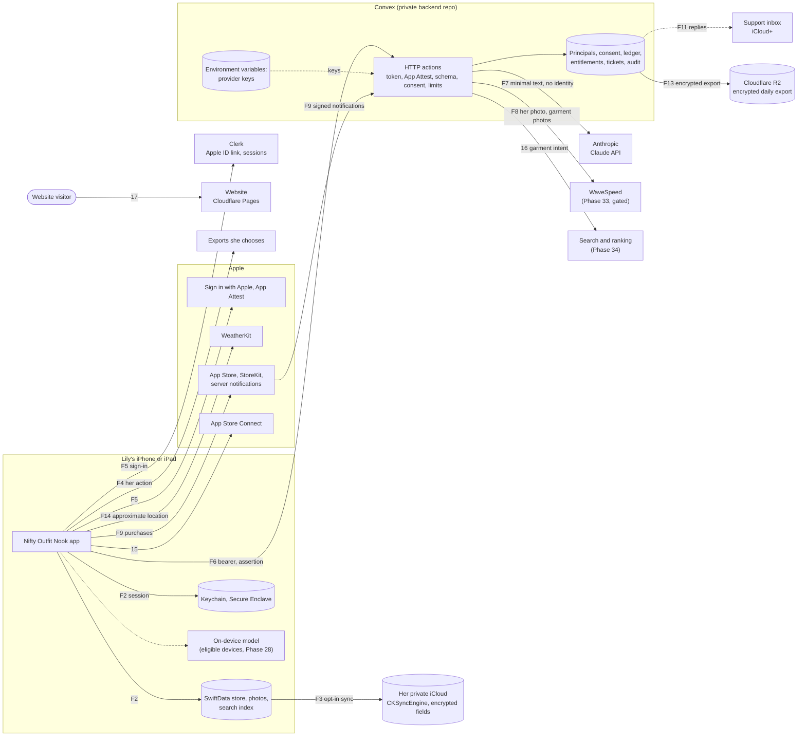

# Data classification and data map

Phase 0c wrote the first version on 13 October 2026. **Phase 19a updated it on 18 October 2026** for the stack Jose chose that day ([STACK.md](STACK.md)): SwiftData with `CKSyncEngine` on the device, Clerk for sign-in, Convex as the backend, the Claude API and WaveSpeed called only from Convex, and Cloudflare R2 for backups. This is the data map required by [SECURITY_STANDARD.md](SECURITY_STANDARD.md) section 1. It covers the whole system as planned in [the master PRD](Nifty_Outfit_Nook_PRD_v2.md) and [the room-direction amendment](PRD_Amendment_Room_Direction.md). The threat model, with a flow-by-flow view (F1 to F14) and the decisions Jose needs to make, is in [THREAT_MODEL.md](THREAT_MODEL.md). The accounts are in [ACCOUNT_INVENTORY.md](ACCOUNT_INVENTORY.md).

**Nothing in Stage B is built or signed up for yet.** Stage A runs on mock data only, with no network, accounts or real storage. Since Phase 17 (16 October 2026) the app keeps a few app state flags across launches in its own `UserDefaults` suite (onboarding finished, the starting closet, the tours seen and the tips switch), and since the Stage A audit (16 October 2026) the first name on her sign and three Style Me settings (Preferences, repeat window, Track laundry). Everything else she adds or types, her fit and measurements included, is still in memory only. See the app repo's `docs/onboarding.md`. Every phase that adds or changes a data flow updates this map (Definition of done, item 6).

Retention values come from PRD section 15.4 unless noted. They are product requirements still to be checked against provider terms and the law (Phase 19b and the legal review in 35a). Provider terms are stated only where they were checked on the provider's official page on 18 October 2026, with the URL in [Processors](#processors). Everything else says **to verify in 19b**.

## Tiers

The tiers are the standard's: **Sensitive**, **Personal**, **Account and billing**, **Secrets** and **Public**. Two rules used below:

- When one record or request mixes tiers, it takes the highest one. A styling request that carries a measurement is Sensitive, even though most of it is wardrobe text.
- Prompts, fit rules, styling rules and model configuration aren't user data and have no tier of their own. They are confidential business logic: private backend repo and Convex only (standard sections 3 and 7), never in the app repo or the app binary.

## Where data can live

| Place | What it is | Who can read it |
|---|---|---|
| **Device** | The app's container on Lily's iPhone or iPad: SwiftData store, image files, search index, caches, Keychain (Clerk session), Secure Enclave (App Attest key). Device backups (iCloud Backup or a computer) copy the container. | Lily. Anyone holding her unlocked phone. |
| **iCloud (private)** | Optional sync through `CKSyncEngine` into a custom zone in her own private CloudKit database. Off unless she turns it on. Sensitive and Personal fields in `encryptedValues`; photos as `CKAsset`. | Lily, on her own devices. Apple holds the keys unless she has Advanced Data Protection on; with ADP, encrypted fields and assets are end-to-end encrypted (Apple support page 102651, checked 16 October 2026). Not readable by Jose or Convex. |
| **Convex** | The backend: HTTP actions as the gateway, a database for principals, consent, ledger, entitlements, support tickets and the audit log, environment variables for keys, and short-lived image staging in Phase 33. Separate dev and production deployments. No closet replica. | Jose through the Convex dashboard and deploy keys; the daily backup job; Convex as processor. Agents only on the dev deployment (THREAT_MODEL R13). |
| **Clerk** | Sign-in provider. Holds the Clerk user (her Apple user ID, optional email and name) and her sessions. Separate dev and production instances. | Jose through the Clerk dashboard; Clerk as processor. |
| **Anthropic** | Claude API, called only from Convex, for the stylist, swaps and Ask stylist. | Anthropic, transiently and under its retention terms. |
| **WaveSpeed** | Image API, called only from Convex, for try-on pictures (Phase 33, gated). | WaveSpeed, transiently and under its retention terms (inputs to verify). |
| **Cloudflare R2** | Private bucket holding the daily encrypted Convex export, 30 days of copies. | Only whoever holds the offline private key can decrypt. Jose; Cloudflare stores the ciphertext. |
| **Apple services** | Sign in with Apple, App Attest, App Store and StoreKit, App Store Server Notifications, App Store Connect (TestFlight, tester feedback, crash reports), WeatherKit. | Apple. Jose sees what App Store Connect shows him. |
| **Support inbox** | The project address on iCloud+ with a custom domain, used for replies. | Jose. Apple operates the mailbox. |
| **Website** | https://niftyoutfitnook.pages.dev/ on Cloudflare Pages. Static, first-party script only, no analytics or forms, strict CSP. | Anyone. Cloudflare sees visitor requests. |
| **Planning repo and review site** | This public repo, and the mockup review site on here.now. | Anyone. See "Data that exists today". |

## Classification

Columns: **Lives** names every place a copy can be, including providers that see it only while processing a request. **What deletes it** names the action or job that removes each copy. Phases are the ones that build the controls; see [SWIFT_BUILD_PLAN.md](SWIFT_BUILD_PLAN.md).

### Lily's body, likeness and health-adjacent data

| Data | Tier | Lives | Retention | What deletes it | Who can read it | Phases |
|---|---|---|---|---|---|---|
| Height, body measurements (waist, bust, inseam and so on), optional weight. Each keeps the unit it was typed in; Fit and measurements and its sheets are hidden in the app switcher, and the values never print in logs (14a) | Sensitive | Device; optional iCloud (encrypted field); Anthropic transiently, only the minimum relevant fact inside a consented styling request. Never to WaveSpeed, Clerk, Convex storage, logs or public search | Until she edits or deletes it. Anthropic: within 30 days, up to 2 years if flagged | Her edit or delete; Delete my data (device and iCloud zone); Anthropic's own deletion | Lily; Anthropic while processing | 14a, 20b, 21a, 24a, 27a |
| Fit feedback about her body ("too long in the leg"), Fit profile notes, reference garments | Sensitive | Same as measurements | Until deleted | Same as measurements | Lily; Anthropic while processing | 14a, 27a |
| Today's comfort (request-scoped, LR-18) | Sensitive (health-adjacent) | Device for the current request; kept with a look only if she chooses; Anthropic transiently, neutral clothing wording only. Raw symptoms or cycle text never accepted | Today only, unless saved with a look | End of day; deleting the look; Delete my data | Lily; Anthropic while processing | 10a, 27a |
| Try-on reference photo of Lily (Profile, "Your try-on photo"). Stage A stores only an example stand-in, with no camera or photo library access | Sensitive (her likeness) | Device; optional iCloud (`CKAsset`); from Phase 33 only, Convex staging and **WaveSpeed** for each try-on job, after its own named-recipient permission | Until she deletes it. Convex staging: deleted when the job ends. WaveSpeed: input retention **to verify in 19b** | Her delete; Delete my data; Convex staging cleanup job; WaveSpeed per its terms | Lily; WaveSpeed while generating | 14a (mock), 22a, 33 |
| Try-on pictures (pictures of her wearing a look). Each record keeps its look's ID and the look as it was; Stage A's are drawn on the phone with no person in them, and hidden in the app switcher | Sensitive | Device; optional iCloud. From Phase 33, generated by WaveSpeed, passed through Convex, then stored only on device and iCloud | Until she deletes them; no automatic expiry, and deleting the look keeps them. WaveSpeed: outputs deleted within 7 days (verified) | Her delete; Delete my data; WaveSpeed's 7-day deletion; Convex staging cleanup | Lily; WaveSpeed during generation and up to 7 days | 12b (simulated), 22b, 33 |
| Any garment or wishlist photo that shows a person (mirror selfie, worn shot) | Sensitive | Device; optional iCloud. Never on the text route; only a separately permissioned photo route after moderation | Until deleted | Her delete; Recently deleted purge; Delete my data | Lily | 22a, 22b, 33 |
| Precise device location | Sensitive | Device only, while in use. The app asks for approximate location; Apple WeatherKit receives it. Coordinates never go to Convex or an AI provider | Not stored | Nothing to delete; the forecast snapshot expires in about 30 minutes | Lily; Apple | 29 |

### Her closet and how she uses it

None of these go to Convex, Clerk or R2. The backend holds no copy of the closet.

| Data | Tier | Lives | Retention | What deletes it | Who can read it | Phases |
|---|---|---|---|---|---|---|
| Garment photos (originals, cutouts, thumbnails), EXIF and GPS stripped at intake | Personal, stored with Sensitive file protection because a photo can show a person or a room | Device; optional iCloud. Not on the text route (Convex rejects images). From Phase 33, selected garment photos go to WaveSpeed with a try-on job | Until deleted; Recently deleted up to 30 days. WaveSpeed: input retention to verify | Her delete, then the 30-day purge or Delete permanently now; Delete my data; staging cleanup | Lily; WaveSpeed while generating | 7b, 8a, 21a, 22a, 22b, 33 |
| Garment details: category, colour, brand, size label, fabric, personal names and aliases, keywords | Personal | Device; optional iCloud; search index; Anthropic transiently, minimal descriptors inside a consented request | Until edited or deleted | Her edit or delete; index rebuild; Delete my data | Lily; Anthropic while processing | 3, 7a, 7b, 21a, 27a |
| Free-text notes (garment notes, Style Me notes, Ask stylist messages) | Sensitive (she can type anything) | Device; optional iCloud; Anthropic transiently, only the text she sends with a consented request, up to 2,000 characters | Notes until deleted. Raw chat or request text not kept as history | Her delete; Delete my data | Lily; Anthropic while processing | 7b, 10a, 27a |
| Saved looks, results, version kind (Simple, Dressed up, Something new), look names, when each was saved | Personal | Device; optional iCloud; bounded recent-look metadata to Anthropic in a consented request | Until deleted | Her delete; Delete my data | Lily | 3, 10b, 11, 12a |
| Unsaved Make your own look draft (name typed so far, pieces, starting piece) | Personal | Device only (in memory in Stage A; a protected file from 21a) | Until she saves the look or chooses Start over | Save, Start over; Delete my data | Lily | 11, 21a |
| Wear records and last worn (LR-10) | Personal | Device; optional iCloud; a recent-wear summary to Anthropic for the repeat rule | Until deleted | Her delete; Delete my data | Lily | 3, 12a, 27a |
| Suitcases and trips (names, picture, members, last used, archived). A deleted suitcase is kept in memory only for its Undo toast | Personal (trip names can reveal where she'll be) | Device; optional iCloud. Requests carry only an ID, never the trip name, unless she includes it | Until deleted | Her delete; Delete my data | Lily | 13 |
| Remembered source and occasion | Personal | Device; optional iCloud (in memory in Stage A). Requests carry the source ID and occasion only | Until changed | Change; fallback to the main closet; Delete my data | Lily | 13, 21a |
| Laundry state (opt-in) | Personal | Device; optional iCloud; availability flags only in requests | Until deleted | Her change; Delete my data | Lily | 13 |
| Preferences (piece mode, repeat window, Track laundry, name on sign, measurement units), style and colour preferences | Personal | Device; optional iCloud. Stage A keeps piece mode, repeat window and Track laundry in the `UserDefaults` suite (`profile.pieceMode`, `profile.repeatWindow`, `profile.tracksLaundry`), included in device backups. The relevant preferences go to Anthropic in a consented request | Until changed | Her change; Delete my data removes the kept values | Lily | 3, 14a, 21a |
| Tour progress: how each quick tour ended and when | Personal (how and when she uses the app; no closet content) | Device; optional iCloud with the other preferences (in memory in Stage A). Sends nothing | Until Delete my data | Delete my data resets it | Lily | 16a, 16b, 21a |
| App state flags (Phase 17): onboarding finished, the starting closet chosen, each tour seen with its content version, the tips switch | Lowest tier, handled as Public: only screen names, version numbers and on/off values. Split out of tour progress on 16 October 2026 for Jose to confirm | Device: the app's own `UserDefaults` suite (`com.jsayram.niftyoutfitnook.appstate`), included in device backups; later with the other preferences, optional iCloud. Sends nothing | Until Delete my data | Delete my data removes them, so the app opens on onboarding again | Lily | 16a, 16b, 17, 21a |
| First name on the sign | Personal | Device; optional iCloud. Stage A keeps it in the `UserDefaults` suite (`profile.signName`). Never put in a prompt, never sent to Clerk or Convex | Until changed | Her change; Delete my data | Lily | 4, 14a, 17, 21a |
| Wishlist pieces, "Thinking of buying?" photos and screenshots, fit checks | Personal | Device; optional iCloud. Clothing-only, moderated photos to a consented route only (LR-12) | Until deleted | Her delete; Delete my data | Lily | 34 |
| Shopping destination country, budget, retailer preferences, purchase reminders | Personal | Device; optional iCloud; reminders as local notifications with no profile or URL in the payload. Country, budget and reviewed intent go to Find One search | Until completed, dismissed or deleted | Her action; Delete my data | Lily; search provider transiently | 34 |
| Local search index, undo history, Recently deleted, migration snapshots | Same as the data they copy | Device; optional iCloud for Recently deleted | Undo 7 days or 100 MB; Recently deleted 30 days; migration snapshot 7 days | Their limits; Delete permanently now; Delete my data | Lily | 11, 20a, 21a, 21b |
| Export archive and shared collages | Same as the data they copy (Sensitive) | Wherever she saves or sends them. The archive is encrypted with a key from her passphrase (decision D10) | Outside the app's control once saved | Only she can delete her copies | Whoever she shares with | 20b, 21b |
| `CKSyncEngine` state file | Personal (record IDs and change tokens, no closet content) | Device | While sync is on | Turning sync off; Delete my data | Lily | 20a, 20b |

### Requests to services

| Data | Tier | Lives | Retention | What deletes it | Who can read it | Phases |
|---|---|---|---|---|---|---|
| Cloud styling request (wardrobe descriptors, fit facts, weather conditions, comfort, notes). No name, email, Clerk ID or photos | Sensitive when it carries fit facts or comfort, Personal otherwise | Built on device; passes through a Convex HTTP action (not stored); Anthropic | Convex keeps no raw payload. Anthropic: deleted within 30 days, up to 2 years if flagged as a usage-policy violation; no training (verified) | Anthropic's automatic deletion | Convex process; Anthropic | 24a, 24b, 27a, 27b |
| Normalized styling result cache | Personal, Sensitive if it echoes fit facts | Convex, encrypted and scoped to her principal | Up to 24 hours | Scheduled Convex job; consent withdrawal; account deletion | Convex process; Jose only as ciphertext | 24b, 27a |
| AI responses (outfits, swap reasons, stylist text) | Personal | Device; optional iCloud once saved | Same as saved looks | As saved looks | Lily | 27a |
| Try-on job (reference photo, garment photos, job record, output) | Sensitive | Convex staging and job table; WaveSpeed; output copied to the device | Staging until the job ends; job record without images until reconciliation; WaveSpeed outputs up to 7 days, inputs to verify | Staging cleanup job; deletion fences; WaveSpeed per its terms | Convex process; WaveSpeed | 33 |
| Garment-understanding upload (optional naming aid) | Personal | Undecided: needs its own named processor, or is left out (22a decides) | Temporary staging; result cache 24 hours | Cleanup job | Processor | 22a |
| Find One public search intent | Personal (sanitized garment intent, no body data) | Convex, transient; search provider | No raw queries in logs; 24-hour result cache | Cache expiry | Search provider | 34 |
| Weather lookup | Location is Sensitive (above); the forecast is Public | Apple WeatherKit, from the device | Session snapshot about 30 minutes | Snapshot expiry | Apple | 29 |
| Weather conditions in a styling request | Personal | Request; Anthropic transiently. Conditions only, never coordinates | As the request | As the request | Anthropic while processing | 27a, 29 |

### Identity, access and money

| Data | Tier | Lives | Retention | What deletes it | Who can read it | Phases |
|---|---|---|---|---|---|---|
| Apple user ID (Sign in with Apple `sub`) | Account and billing | Apple; Clerk (on the Clerk user) | Until account deletion | Account deletion deletes the Clerk user and revokes the Apple link. Clerk's retention after deletion: to verify in 19b | Jose (Clerk dashboard); Clerk; Apple | 24a, 24c |
| Email (Apple private relay or real) and name, only if requested from Apple | Personal | Clerk. Not copied into Convex unless a feature needs it | Until account deletion | Same as the Apple user ID | Jose; Clerk | 24a (decision D6) |
| Clerk user ID and styling principal ID, and the map between them | Account and billing | Clerk (user ID); Convex (principal table); R2 backups | Until account deletion, then only documented billing or security records | Account deletion; backups age out in 30 days; deletion record reapplied after a restore | Jose | 24a, 24c, 25b |
| Clerk session and session tokens | Account and billing (credentials) | Device Keychain (accessibility class to confirm for `clerk-ios`); Clerk. Convex checks each token but doesn't store it | Session fixed at 7 days on Clerk's free plan (verified); token lifetime to verify in 24a | Sign-out, expiry, account deletion | No person | 24a |
| Any session metadata Clerk records (what it records is to verify) | Personal | Clerk | To verify in 19b | Account deletion (to verify) | Jose; Clerk | 19b, 24a |
| App Attest key, attestation and counter | Account and billing | Private key in the Secure Enclave; public key and counter in Convex; R2 backups | Per key lifetime | Account deletion; key rotation | No person | 24a |
| Consent receipts (recipient, purpose, data categories, version) | Account and billing | Convex, mirrored on device; R2 backups | While active, then the minimum lawful record | Withdrawal ends it; account deletion keeps only the lawful minimum | Jose | 19b, 24a |
| Usage ledger, reservations, rate-limit state | Account and billing | Convex; R2 backups | Usage window plus a documented lawful period; survives data deletion so limits can't be reset | Scheduled expiry after the lawful period | Jose | 24b |
| Subscription status, entitlements, credit balances, transaction IDs, App Store Server Notifications log | Account and billing | Apple; Convex is the authority, device shows it; R2 backups | Documented billing period | Scheduled expiry after the billing period | Jose; Apple | 30a, 30b, 30c |
| Offer codes before they are redeemed | Secrets (until redeemed) | App Store Connect, Jose's password manager | Until redeemed or expired | Redemption or expiry | Jose | 30b |
| Security and audit events (sign-ins, attestation failures, entitlement and credit changes, admin, price, model and budget changes). No personal data | Account and billing | Convex; R2 backups | 30 days identifiable, then aggregated without identifiers | Scheduled Convex job | Jose | 24a, 25b |
| Account deletion records (pseudonymous principal ID and date) | Account and billing | Convex, kept apart from the deleted data | As long as backups or restores could bring data back, then the lawful minimum | Expiry after the backup window | Jose | 24c, 25b |
| Convex daily export | Highest tier it holds: Personal and Account and billing | Cloudflare R2, encrypted with a public key before upload | 30 days | R2 lifecycle rule | Whoever holds the offline private key (Jose) | 25a, 25b |

### Feedback, support and analytics

| Data | Tier | Lives | Retention | What deletes it | Who can read it | Phases |
|---|---|---|---|---|---|---|
| Private feedback and support reports (Send feedback drawer). Closet data, measurements, looks and her name never attached; app, iOS version and device model only if she turns on "Include app details" | Personal (free text) | Stage A: in memory until Send hands the exact text to the share sheet. From 24d: Convex support table; R2 backups | 90 days after closure; backups 30 days more | Scheduled Convex job; account deletion; R2 lifecycle | Jose | 14b (built), 24d |
| Reply address she gives with a report | Personal | Convex with the ticket; the support inbox when Jose replies | With the ticket; mail kept by Jose's mailbox until he deletes it | Ticket deletion; Jose deletes the thread | Jose; Apple runs the mailbox | 24d |
| Public feedback board posts and votes, public alias | Public once approved; the alias-to-account link is Personal | Convex if built | Until deleted or removed; moderation records 90 days | Her delete; moderation; account deletion | Anyone (posts); Jose (link) | 24d decides |
| Optional welcome and check-in email address | Personal | Not planned (PRD 22.4) | While opted in; deleted within 30 days of a request | Unsubscribe or request | Jose; email processor | Not planned |
| Crash reports | Personal (device and app state), no user content | Apple (Xcode Organizer, TestFlight); any tool approved in 31 | Apple's terms | Apple | Jose | 18, 31 |
| TestFlight feedback and screenshots | Personal; screenshots can show her closet or try-on pictures | App Store Connect | Until Jose deletes it | Jose, in App Store Connect | Jose | 18 |
| Optional improvement analytics (allowlisted events, resettable ID) | Personal (pseudonymous) | Convex if built | Raw 30 days; queued 7 days | Scheduled job; withdrawal | Jose | 31 |
| Operational metrics (latency, error category, cost, token counts) | Account and billing when tied to a principal, otherwise aggregates | Convex | 30 days identifiable, then aggregated | Scheduled job | Jose | 24b, 27b, 31 |
| Convex function logs | Should hold no personal data: action IDs, error categories, cost and latency only | Convex | To verify in 24a | Convex's own retention | Jose; agents on dev only | 24a |

### Secrets and public data

| Data | Tier | Lives | Notes | Phases |
|---|---|---|---|---|
| Claude API key, WaveSpeed key, Sign in with Apple key, App Store Server API key | Secrets | Convex environment variables, one set per deployment | Never in the app, either repo, logs or chat. One key per purpose and environment, rotation date in the account inventory | 25a |
| Clerk secret key and Convex's Clerk provider settings | Secrets (secret key); config (issuer, audience) | Convex environment variables | The Clerk publishable key ships in the app and is not a secret | 24a, 25a |
| Convex production deploy key | Secrets | Protected GitHub environment in the private backend repo (backup job, deploys) | Never in a public repo or an agent session | 25a, 25b |
| Backup encryption key pair | Secrets (private key); public key is not secret | Public key in CI; private key offline with Jose | A leaked CI secret can't read old backups | 25b |
| R2 token for the backup job | Secrets | Same protected environment | Write objects to one bucket only | 25b |
| Signing certificates and provisioning profiles | Secrets | Jose's keychain; a protected CI environment only if CI signs | | 1b, 18 |
| Cloudflare, here.now and GitHub tokens | Secrets | Jose's password manager or local tool config | Never committed. The closet repo's `.herenow/` stays untracked | 0c, 25a |
| Account passwords and recovery codes | Secrets | Password manager; recovery codes offline | Standard section 2 | 0c |
| Room art, palette, tour copy, help text, fixture closets, website pages, App Store listing | Public | App bundle, app repo, website | Fixtures use synthetic garments and AI-generated stand-in people, never real photos of Lily | 2a, 3, 16a, 35b |

## Processors

Every company that receives her data, with what was verified on its official page on 18 October 2026 and what still needs an answer. These feed the consent text and privacy policy (19b), and their rows in [ACCOUNT_INVENTORY.md](ACCOUNT_INVENTORY.md).

### Clerk

- **Receives:** her Apple user ID, optional email and name, session records.
- **Verified:**
  - Acts as a processor for customer data, and data "may be transferred, processed, and stored anywhere in the world". Privacy policy updated 15 June 2026: https://clerk.com/legal/privacy
  - Hobby plan: "Fixed, 7 day session lifetime". Custom session length on Pro at $25 a month, $20 billed yearly: https://clerk.com/pricing
  - `clerk-ios` is MIT licensed; the `ClerkKit` target has no third-party dependencies and `ClerkKitUI` uses Nuke and PhoneNumberKit (GitHub `clerk/clerk-ios`, `Package.swift`).
- **Open questions:** retention after a user is deleted; sub-processor list and a DPA; which session metadata (IP, device) it records and for how long; session token lifetime; Keychain accessibility class in `clerk-ios`; whether deleting a user revokes Apple's sign-in link; whether it needs an email from Apple; any dashboard feature that lets an admin act as a user, and how to keep it off.

### Convex

- **Receives:** principal map, consent receipts, ledger, entitlements, transaction IDs, support tickets, reply addresses, audit events, App Attest public keys; styling requests and try-on photos pass through.
- **Verified:**
  - Deployments run on AWS in one of `aws-us-east-1`, `aws-eu-west-1`, `aws-ap-southeast-2` or `aws-ca-central-1`; non-US usage costs 1.3 times: https://docs.convex.dev/production/regions
  - The MCP server can't reach production unless started with `--dangerously-enable-production-deployments`, and can read tables, run functions and manage environment variables on the deployments it reaches: https://docs.convex.dev/ai/convex-mcp-server
- **Open questions:** which region our deployments use (US expected); encryption at rest; how long function logs are kept; whether a database export can exclude tables; its sub-processor list and DPA; whether file storage URLs for Phase 33 staging can be made short-lived or private.

### Anthropic (Claude API)

- **Receives:** minimal styling context with no identity and no photos.
- **Verified:**
  - "Anthropic may not train models on Customer Content from Services." Commercial Terms, effective 17 June 2025: https://www.anthropic.com/legal/commercial-terms
  - Inputs and outputs deleted "within 30 days of receipt or generation". Content flagged for usage-policy violations kept up to 2 years and classifier scores up to 7 years. Zero data retention only by negotiated agreement. Page updated 1 July 2026: https://privacy.claude.com/en/articles/7996866-how-long-do-you-store-my-organization-s-data
  - Inference runs in any geography by default (`inference_geo: "global"`). `"us"` pins it to the US at 1.1 times the price, on Claude 4.6 and later models only; Haiku 4.5 returns an error. Workspace data at rest is US only: https://platform.claude.com/docs/en/manage-claude/data-residency
- **Open questions:** whether zero data retention is offered to an account this size; whether Jose's API account sits under the Commercial Terms (not consumer terms); Sonnet 5.5's and any newer Haiku's cost with US-only inference (27a); sub-processors.

### WaveSpeed

- **Receives (Phase 33 only):** her try-on reference photo and selected garment photos; returns generated pictures of her.
- **Verified:**
  - Generated media (images, video, audio, other outputs) kept "Up to 7 days"; prediction metadata kept "as needed" for history, billing, security and support: https://www.wavespeed.ai/docs/data-retention-policy
  - The operating company is WaveSpeedAI PTE. LTD., Singapore. The privacy policy (updated 25 September 2026) says customer personal information is kept "as long as necessary", may be shared with vendors and service providers, and doesn't say where data is processed: https://wavespeed.ai/static/privacy
- **Not verified:** search results attribute a no-training statement to WaveSpeed, but neither official page above says so. Treat training use as unknown.
- **Open questions:** how long uploaded **inputs** are kept; training use, in its terms; processing location; whether inputs go to the model's maker (Seedream is a ByteDance model) and under which terms; whether inputs need a public URL; whether outputs sit on a CDN URL anyone can open; deletion on request; content moderation. The current prepaid account was opened for test images (PR #56); a production account and key per environment come in 25a.

### Cloudflare R2

- **Receives:** the encrypted daily Convex export.
- **Verified:** all objects and metadata are encrypted at rest with AES-256 (GCM), and transfers use TLS: https://developers.cloudflare.com/r2/reference/data-security/
- **Open questions:** bucket lock or object lock to stop early deletion; lifecycle rule behaviour; whether the backup bucket goes in a Cloudflare account separate from the website; R2 token scopes for write-only access.

### Apple

Apple is a processor too (iCloud, Sign in with Apple, App Attest, StoreKit, WeatherKit, App Store Connect, the iCloud+ mailbox). Its terms come with the developer program and her own Apple Account; 19b lists what the privacy policy must say about each.

## Data map

The table lists every flow, the tier that crosses it and the phase that builds it. Flow IDs match the threat model's F1 to F14 where they cover the same path.

| # | From | To | What crosses | Highest tier | When | Phases |
|---|---|---|---|---|---|---|
| F1 | Photos or camera | App | Selected photos; metadata stripped before the first write | Sensitive | When she adds a garment or try-on photo | 22a |
| F2 | App | Device storage and Keychain | Everything she enters, photos, the Clerk session | Sensitive | Always | 21a, 22b, 24a |
| F3 | App | Her private iCloud | Synced closet, profile, looks, photos | Sensitive | Only if she turns sync on | 20b |
| F4 | App | Wherever she chooses | Encrypted export, collage, prompt share | Sensitive | Her explicit action | 20b, 21b |
| F5 | App | Apple, then Clerk | Sign in with Apple identity token; session back | Account and billing | Sign-in | 24a |
| F6 | App | Convex HTTP actions | Bearer token, App Attest assertion, consented request | Sensitive | Cloud styling, feedback, purchases, deletion | 24a, 24b |
| F7 | Convex | Anthropic | Minimal styling context, no identity, no photos | Sensitive | After consent, entitlement, limits and reservation pass | 24b, 27a |
| F8 | Convex | WaveSpeed | Her try-on photo and selected garment photos | Sensitive (her likeness) | Only after Phase 33's gates and separate permission | 33 |
| F9 | App and Apple | Convex | Purchases; signed App Store Server Notifications | Account and billing | Purchase, renewal, refund | 30a, 30c |
| F10 | Convex | Convex | Ledger reservations and settlement | Account and billing | Every paid call | 24b, 30c |
| F11 | App | Convex, then the support inbox | Feedback text, optional reply address | Personal | When she sends feedback | 14b, 24d |
| F12 | App | Device, iCloud, Convex, Clerk, Apple | Deletion requests | Account and billing | When she deletes her data or account | 20b, 24c |
| F13 | Convex | GitHub runner, then R2 | Daily export, encrypted before upload | Personal | Daily | 25b |
| F14 | App | Apple WeatherKit | Approximate location | Sensitive | When weather is shown or used | 29 |
| 15 | App | App Store Connect | Crash reports, TestFlight feedback | Personal | When she shares them | 18, 31 |
| 16 | Gateway | Search and ranking providers | Sanitized garment intent; minimal fit facts to ranking only | Sensitive (ranking) | Only when she taps Find one | 34 |
| 17 | Visitor | Website | Page requests | Public | Always | 19b, 35b |
| 18 | Jose and agents | GitHub, Apple Developer, Convex, Clerk, Claude Console, WaveSpeed, Cloudflare | Code, builds, config, keys | Secrets | Development and operations. Agents on dev deployments only | 1b, 25a |

## Data that exists today

The app holds no real data yet, but two places already hold personal information about Lily, and both are public:

- **This planning repo is public.** The PRD, the feedback files, the amendment and the old prototype quote Lily and include some of her body and personal details. Under section 1 of the standard, some of that is Sensitive. Jose accepted this on 7 October 2026 (risk R1 in [THREAT_MODEL.md](THREAT_MODEL.md)). New docs keep body and health details out where they aren't needed.
- **The mockup review site on here.now** stores Lily's review notes. Anyone with the link can read and add notes; changing or deleting them needs the owner key.

The sample wardrobe made with WaveSpeed for PR #56 shows AI-generated stand-in people, not Lily, and none of her photos were sent.

From now on, new planning docs should describe Lily's needs without her body or health details, and should refer to "the primary user" where a detail isn't needed.

## Open points for later phases

- **Export encryption.** PRD 15.4 describes a "portable unencrypted archive". The standard requires exports that leave the app to be encrypted. The standard wins unless Jose approves an exception in writing (decision D10). Phase 20b decides the format.
- **iCloud encryption.** Which fields use `encryptedValues` and what Lily sees with and without Advanced Data Protection. Phase 20b, before the schema is promoted.
- **Provider terms.** Every "to verify" in [Processors](#processors) is answered in 19b and recorded in ACCOUNT_INVENTORY.md before the provider receives her data. WaveSpeed's answers decide decision D1.
- **Feedback board and email program.** Phase 24d builds the support queue and decides on the board and email program.
- **Data residency.** Clerk may process data anywhere, Anthropic runs Haiku 4.5 inference in any geography, and WaveSpeed doesn't say. The lawyer in 19b and 35a confirms what the privacy policy must say.
