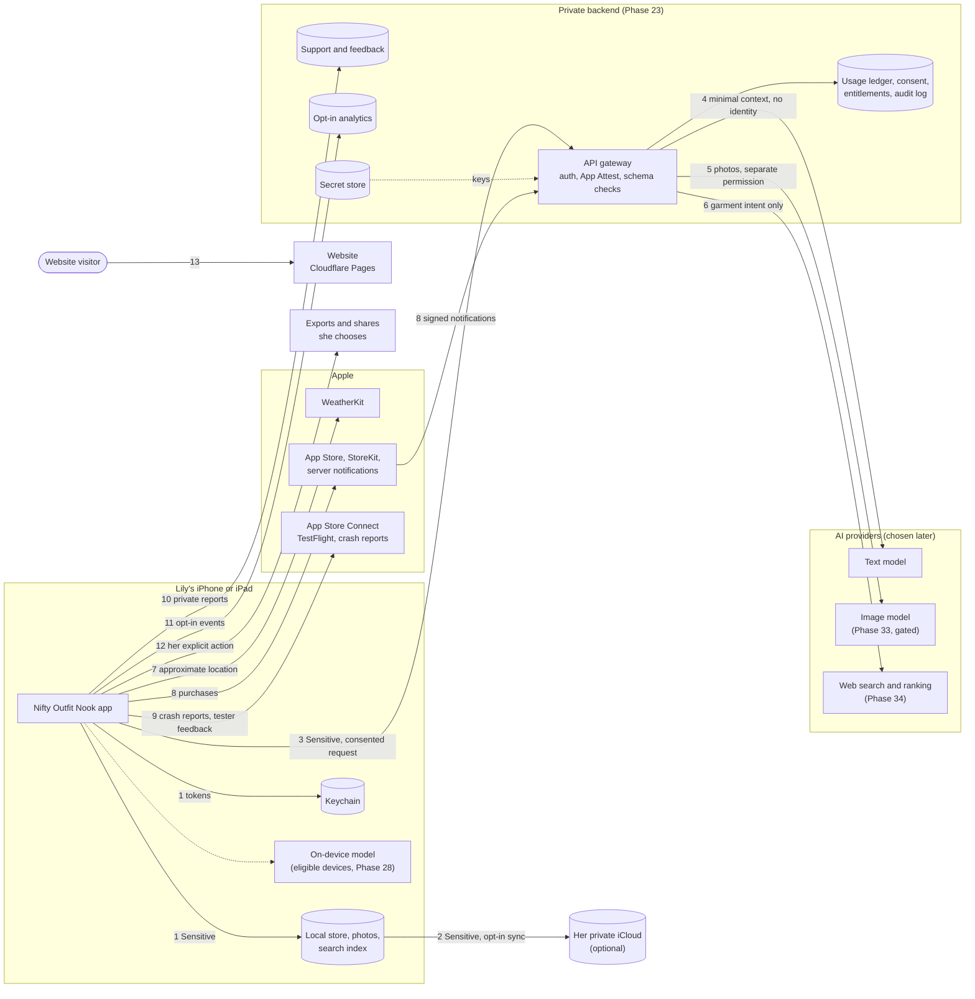

# Data classification and data map

Phase 0c, written 13 October 2026. This is the first data map required by [SECURITY_STANDARD.md](SECURITY_STANDARD.md) section 1. It covers the whole system as planned in [the master PRD](Nifty_Outfit_Nook_PRD_v2.md) and [the room-direction amendment](PRD_Amendment_Room_Direction.md). The threat model is in [THREAT_MODEL.md](THREAT_MODEL.md) and the accounts are in [ACCOUNT_INVENTORY.md](ACCOUNT_INVENTORY.md).

Nothing here is built yet. Stage A runs on mock data only, with no network, accounts or real storage, so today the only real data in the system is the planning material in this repo and the review notes on the mockup site (see "Data that exists today" below). Since Phase 17 (16 October 2026) the app keeps a few app state flags across launches in its own `UserDefaults` suite (onboarding finished, the starting closet, the tours seen and the tips switch); everything she adds or types, her name included, is still in memory only. See the app repo's `docs/onboarding.md`. Phase 19a revisits this map before real data arrives, and every phase that adds or changes a data flow updates it (Definition of done, item 6).

Retention values come from PRD section 15.4 unless noted. They are product requirements still to be checked against provider terms and the law (Phase 19b and the legal review in 35a).

## Tiers

The tiers are the standard's: **Sensitive**, **Personal**, **Account and billing**, **Secrets** and **Public**. Two rules used below:

- When one record or request mixes tiers, it takes the highest one. A styling request that carries a measurement is Sensitive, even though most of it is wardrobe text.
- Prompts, fit rules, styling rules and model configuration aren't user data and have no tier of their own. They are confidential business logic: private backend repo only (standard sections 3 and 7), never in the app repo or the app binary.

## Where data can live

| Place | What it is | Who can read it |
|---|---|---|
| **Device** | The app's container on Lily's iPhone or iPad: local store, image files, search index, caches, Keychain | Lily. Anyone holding her unlocked phone. |
| **iCloud (private)** | Optional sync through her own private CloudKit database. Off unless she turns it on. | Lily, on her own devices. Apple operates it; it is not readable by Jose or the backend. How much is end-to-end encrypted depends on CloudKit encrypted fields and her Advanced Data Protection setting, to be confirmed in Phase 20b. |
| **Backend gateway** | The private backend chosen in Phase 23 (gateway, identity, usage ledger, consent records, feedback, support). | Jose as operator, through least-privilege roles. No closet replica. |
| **AI providers** | Cloud text model (stylist, swaps, Ask stylist), later image model (try-on, Phase 33), garment-understanding model and web search/ranking (Find One, Phase 34). Chosen in Phases 23 and 27a. | The provider, under its own retention and training terms. Never called directly by the app. |
| **Apple services** | App Store and StoreKit, App Store Connect (TestFlight builds, tester feedback, crash reports), WeatherKit, App Attest, Sign in with Apple. | Apple. Jose sees what App Store Connect shows him. |
| **Website** | https://niftyoutfitnook.pages.dev/ on Cloudflare Pages. Static. A first-party script only (`/site.js`, no tracking), no analytics or forms, and a strict Content Security Policy (`script-src 'self'`, `form-action 'none'`). | Anyone. Cloudflare sees visitor requests. |
| **Planning repo and review site** | This public repo, and the mockup review site on here.now where Lily leaves notes. | Anyone. See "Data that exists today". |

## Classification

"Leaves the device" means it is sent somewhere other than her own device and her own iCloud. Phases in the last column are the ones that build the controls; see [SWIFT_BUILD_PLAN.md](SWIFT_BUILD_PLAN.md).

### Lily's body, likeness and health-adjacent data

| Data | Tier | Lives | Leaves the device? | Retention | Who can see it | Phases |
|---|---|---|---|---|---|---|
| Height, body measurements (waist, bust, inseam and so on), optional weight. Each keeps the unit it was typed in; Fit and measurements and its sheets are hidden in the app switcher, and the values never print in logs (14a) | Sensitive | Device, optional iCloud | Only the minimum relevant fact, inside a consented cloud styling or fit-ranking request. Never to public web search. | Until she edits or deletes it | Lily; the AI provider transiently | 14a, 21a, 24a, 27a |
| Fit feedback about her body ("too long in the leg"), Fit profile notes, reference garments | Sensitive | Device, optional iCloud | Same as measurements | Until deleted | Lily; AI provider transiently | 14a, 27a |
| Today's comfort (request-scoped, LR-18) | Sensitive (health-adjacent) | Device, for the current request; kept with a look only if she chooses | Neutral clothing wording only, inside a consented request. Raw symptoms or cycle text are never accepted. | Today only, unless saved with a look | Lily; AI provider transiently | 10a, 27a |
| Try-on reference photo of Lily (Profile, "Your try-on photo"). Stage A stores only an example stand-in, with no camera or photo library access | Sensitive | Device, optional iCloud | Only to the named image provider, after its own separate permission, once Phase 33's gates pass | Until she deletes it | Lily; image provider under its terms | 14a (mock sheet only), 33 |
| Try-on pictures (simulated pictures of her wearing a look). Each record keeps its look's ID and the look as it was (pieces, name, occasion); Stage A's are drawn on the phone from those pieces with no person in them, and hidden in the app switcher | Sensitive | Device, optional iCloud | Produced by the image provider; stored only on device and iCloud | Until she deletes them; no automatic expiry, and deleting the look keeps them | Lily; image provider during generation | 12b (simulated only), 33 |
| Any garment or wishlist photo that shows a person (mirror selfie, worn shot) | Sensitive | Device, optional iCloud | No, unless a separately permissioned photo route accepts it, after moderation | Until deleted | Lily | 22a, 22b, 33 |
| Precise device location | Sensitive | Device only, while in use | No. The app asks for approximate, while-in-use location for weather. Coordinates never go to an AI provider. | Not stored; used for the weather lookup | Lily; Apple WeatherKit receives the location | 29 |

### Her closet and how she uses it

| Data | Tier | Lives | Leaves the device? | Retention | Who can see it | Phases |
|---|---|---|---|---|---|---|
| Garment photos (originals, cutouts, thumbnails) | Personal, stored with Sensitive file protection because a photo can show a person or a room | Device, optional iCloud | Not in V1 text styling (the gateway rejects images). Only through her own export or share, or a separately permissioned photo route later. EXIF and location stripped first. | Until deleted; Recently deleted up to 30 days | Lily | 7b, 8a, 22a, 22b |
| Garment details: category, colour, brand, size label, fabric, personal names and aliases, keywords | Personal | Device, optional iCloud, search index | Minimal descriptors inside a consented styling request | Until edited or deleted | Lily; AI provider transiently | 3, 7a, 7b, 21a |
| Free-text notes (garment notes, Style Me notes, Ask stylist messages) | Sensitive (the standard's "private notes"; she can type anything) | Device, optional iCloud | Only the text she sends with a consented request, bounded to 2,000 characters | Notes until deleted. Raw chat or request text is not kept as history. | Lily; AI provider transiently | 7b, 10a, 27a |
| Saved looks, results, version kind (Simple, Dressed up, Something new), look names, when each was saved | Personal | Device, optional iCloud | Bounded recent-look metadata in a consented request | Until deleted | Lily | 3, 10b, 11, 12a |
| Unsaved Make your own look draft (name typed so far, pieces, starting piece) | Personal | Device only (in memory in Stage A) | No | Until she saves the look or chooses Start over | Lily | 11, 21a |
| Wear records and last worn (LR-10) | Personal | Device, optional iCloud | Recent-wear summary only, for the repeat rule | Until deleted | Lily | 3, 12a, 27a |
| Suitcases and trips (names, picture, members, last used, archived). A deleted suitcase is kept in memory only for its Undo toast | Personal (trip names can reveal where she'll be) | Device, optional iCloud | Only the scope of the current request (an ID, never the trip name), unless she includes it | Until deleted | Lily | 13 |
| Remembered source and occasion (the suitcase or main closet and the occasion Style Me starts from) | Personal (a suitcase can say where she'll be) | Device, optional iCloud (in memory in Stage A) | Only as the current request's source ID and occasion | Until changed; a deleted or archived source falls back to the main closet | Lily | 13, 21a |
| Laundry state (opt-in) | Personal | Device, optional iCloud | Availability flags only | Until deleted | Lily | 13 |
| Preferences (piece mode, repeat window, Track laundry, name on sign, measurement units), style and colour preferences | Personal | Device, optional iCloud | The relevant preferences in a consented request | Until changed | Lily | 3, 14a |
| Tour progress: how each quick tour ended and when | Personal (how and when she uses the app; no closet content, body values or identifier) | Device, optional iCloud with the other preferences (in memory, for the session only, in Stage A) | No. Tours make no network call and send nothing. | Until Delete my data, which resets it with the profile | Lily | 16a, 16b, 21a |
| App state flags (Phase 17): onboarding finished, the starting closet chosen (sample or empty), each tour seen with its content version, and the "Show tips on new screens" switch | Lowest tier, handled as Public: only the app's own screen names, version numbers and on/off values, with no name, nothing she typed, nothing about her body or closet, no dates and no identifier. Split out of the tour progress row on 16 October 2026 for Jose to confirm | Device: the app's own `UserDefaults` suite (`com.jsayram.niftyoutfitnook.appstate`), kept across launches in Stage A and included in device backups; later with the other preferences, optional iCloud | No | Until Delete my data, which removes them, so the app opens on onboarding again | Lily | 16a, 16b, 17, 21a |
| First name on the sign | Personal | Device, optional iCloud. Stage A: typed in onboarding or Profile, kept in memory only, so a relaunch shows Hello until she types it again (Phase 17) | No. It is never put in a prompt. | Until changed | Lily | 4, 14a, 17 |
| Wishlist pieces, "Thinking of buying?" photos and screenshots, fit checks | Personal | Device, optional iCloud | Clothing-only, moderated photos to a consented route only (LR-12). | Until deleted | Lily | 34 |
| Shopping destination country, budget, retailer preferences, purchase completion reminders | Personal | Device, optional iCloud; reminders as local notifications | Country, budget and reviewed garment intent go to Find One search. No profile or URL in notification payloads. | Until completed, dismissed or deleted | Lily; search provider transiently | 34 |
| Local search index, undo history, Recently deleted, migration snapshots | Same as the data they copy | Device, optional iCloud | No | Undo 7 days or 100 MB; Recently deleted 30 days; migration snapshot 7 days | Lily | 11, 20a, 21a, 21b |
| Export archive and shared collages | Same as the data they copy | Wherever she saves or sends them | Yes, by her explicit choice | Outside the app's control once saved | Whoever she shares with | 20b, 21b |

### Requests to services

| Data | Tier | Lives | Leaves the device? | Retention | Who can see it | Phases |
|---|---|---|---|---|---|---|
| Cloud styling request (StyleRequest: wardrobe descriptors, fit facts, weather conditions, comfort, notes) | Sensitive when it carries fit facts or comfort, Personal otherwise | Built on device, passes through the gateway | Yes, to the consented AI provider only, through the gateway | Gateway keeps no raw payload. A normalized, encrypted, per-user result cache expires within 24 hours. Provider retention per its terms, recorded in the inventory. | Gateway process; AI provider | 24a, 24b, 27a, 27b |
| AI responses (outfits, swap reasons, stylist text) | Personal | Device, optional iCloud once saved | Arrives from the gateway | Same as saved looks; gateway cache 24 hours | Lily | 27a |
| Garment-understanding upload (optional naming aid) | Personal | Temporary upload | Yes, to its own named, consented processor | Temporary staging with bounded cleanup; result cache 24 hours | Processor | 22a, later decision |
| Find One public search intent | Personal (sanitized garment intent, no body data) | Gateway, transient | Yes, to the search provider | No raw queries in logs; 24-hour result cache | Search provider | 34 |
| Weather lookup | Location is Sensitive (above); the forecast itself is Public | WeatherKit | Yes, location to Apple WeatherKit | Session snapshot about 30 minutes | Apple | 29 |
| Weather conditions in a styling request | Personal | Request | Conditions only, never coordinates | As the request | AI provider transiently | 27a, 29 |

### Identity, access and money

| Data | Tier | Lives | Leaves the device? | Retention | Who can see it | Phases |
|---|---|---|---|---|---|---|
| Sign in with Apple user ID, styling principal ID | Account and billing | Backend; device holds only tokens | Yes | Until account deletion, then only documented billing or security records | Jose as operator | 24a, 24c |
| Apple relay or real email from Sign in with Apple | Personal | Backend, only if a feature needs it | Yes | Until account deletion | Jose | 24a |
| Session access and refresh tokens | Account and billing (credentials) | Device Keychain, `WhenUnlockedThisDeviceOnly`; backend | Yes | Short-lived, rotated, revoked on sign-out and deletion | No person | 24a |
| App Attest keys and attestation results | Account and billing | Key in the Secure Enclave; results on the backend | Attestation only | Per key lifetime | No person | 24a |
| Consent receipts (recipient, purpose, data categories, version) | Account and billing | Backend, mirrored on device | Yes | While active, then the minimum lawful record | Jose | 24a, 19b |
| Usage ledger, reservations, rate-limit state | Account and billing | Backend | n/a | Usage window plus documented lawful period; survives data deletion so limits can't be reset | Jose | 24b |
| Subscription status, entitlements, credit balances, transaction IDs, App Store Server Notifications | Account and billing | Backend is the authority; device shows them | Yes | Documented billing period | Jose; Apple | 30a, 30b, 30c |
| Offer codes for complimentary access, before they are redeemed | Secrets (until redeemed) | App Store Connect, Jose's password manager | Given to the person they're for | Until redeemed or expired | Jose | 30b |
| Security and audit events (sign-ins, attestation failures, entitlement and credit changes, admin actions) | Account and billing | Backend logs | n/a | 30 days for identifiable events, then aggregated without identifiers | Jose | 24a, 25b |

### Feedback, support and analytics

| Data | Tier | Lives | Leaves the device? | Retention | Who can see it | Phases |
|---|---|---|---|---|---|---|
| Private feedback and support reports (Send feedback drawer) | Personal (free text; she may mention anything) | Backend support queue. Until it exists (Stage A, 14b), an unsent note is kept in memory only, and Send hands the exact text to the system share sheet, so it goes wherever she sends it (Messages, Mail) | Yes, when she sends it. Closet data, measurements, looks and her name are never attached; the app version, iOS version and device model only if she turns on "Include app details", and she sees the exact text first. | 90 days after closure; in Stage A, whatever the app she sent it with keeps | Jose; in Stage A, whoever she sends it to | 14b (form and share sheet), no real phase yet |
| Public feedback board posts and votes, public alias | Public once approved; the link between alias and account is Personal | Backend | Yes | Until deleted or removed; moderation records 90 days | Anyone (posts); Jose (account link) | Not in Stage A; no phase yet |
| Optional welcome and check-in email address | Personal | Backend or email processor | Yes | While opted in; deleted within 30 days of a request | Jose; email processor | Not planned yet (PRD 22.4) |
| Crash reports | Personal (device and app state), must hold no user content | Apple (TestFlight and App Store crash reports); any crash tool picked in Phase 31 | Yes, when the user shares diagnostics with developers | Provider's terms | Jose | 18, 31 |
| TestFlight tester feedback and screenshots | Personal; screenshots can show her closet or try-on pictures | App Store Connect | Yes, when she sends it | Until Jose deletes it in App Store Connect | Jose | 18 |
| Optional improvement analytics (allowlisted events, resettable ID) | Personal (pseudonymous) | Backend | Only after opt-in; off by default | Raw events 30 days; queued events 7 days | Jose | 31 |
| Operational metrics (latency, error category, cost, token counts) | Account and billing when tied to a principal, otherwise Public-grade aggregates | Backend | n/a | 30 days identifiable, then aggregated | Jose | 24b, 27b, 31 |

### Secrets and public data

| Data | Tier | Lives | Notes | Phases |
|---|---|---|---|---|
| AI provider keys, backend service keys, database service role key, webhook secrets, App Store Server API and App Store Connect API keys | Secrets | Backend secret store per environment | Never in the app, either repo, logs or chat. One key per purpose, rotation date in the account inventory. | 25a |
| Signing certificates and provisioning profiles | Secrets | Jose's keychain and, if CI signs builds, a protected CI environment | | 1b, 18 |
| Cloudflare, here.now and GitHub tokens | Secrets | Jose's password manager or local tool config | Never committed. The closet repo's `.herenow/` stays untracked. | 0c, 25a |
| Account passwords and recovery codes | Secrets | Password manager; recovery codes offline | Standard section 2. | 0c |
| Room art, palette, tour copy, help text, fixture closets, website pages, App Store listing | Public | App bundle, app repo, website | Fixtures use synthetic garments only, never real photos of Lily. | 2a, 3, 16a, 35b |

## Data map

The table says which flows exist, what tier crosses each one and which phase builds it. Arrows in the diagram follow the same numbers.

| # | From | To | What crosses | Highest tier | When | Phases |
|---|---|---|---|---|---|---|
| 1 | App | Device storage and Keychain | Everything she enters, photos, tokens. Stage A writes only the app state flags, to `UserDefaults` | Sensitive (Stage A: lowest tier) | Always | 17, 21a, 22b, 24a |
| 2 | App | Her private iCloud | Synced closet, profile, looks, photos | Sensitive | Only if she turns sync on | 20b |
| 3 | App | Backend gateway | Consented styling request, App Attest assertion, session token | Sensitive | When she asks for cloud styling (iPhone 12 always uses cloud) | 24a, 24b, 27a |
| 4 | Gateway | AI text provider | Minimal styling context with no identity | Sensitive | After consent, entitlement, limits and cost reservation pass | 24b, 27a |
| 5 | Gateway | Image provider | Try-on reference photo and selected garment photos | Sensitive | Only after Phase 33's gates and separate permission | 33 |
| 6 | Gateway | Search and ranking providers | Sanitized garment intent; minimal permissioned fit facts to ranking only | Personal (search), Sensitive (ranking) | Only when she taps Find one | 34 |
| 7 | App | Apple WeatherKit | Approximate location | Sensitive | When weather is shown or used | 29 |
| 8 | App and backend | App Store and StoreKit | Purchases, transactions, server notifications | Account and billing | Purchase, restore, renewal, refund | 30a, 30c |
| 9 | App | App Store Connect | Crash reports, TestFlight feedback | Personal | When she shares them | 18, 31 |
| 10 | App | Backend support and feedback | Private reports; later, board posts | Personal | When she sends feedback | No phase yet |
| 11 | App | Backend analytics | Allowlisted events | Personal | Only after opt-in | 31 |
| 12 | App | Wherever she chooses | Export archive, collage and prompt share | Sensitive | Her explicit action | 20b, 21b |
| 13 | Visitor | Website | Page requests | Public | Always | 19b, 35b |
| 14 | Jose | GitHub, Apple Developer, Cloudflare, backend, AI consoles | Code, builds, config, keys | Secrets | Development and operations | 1b, 25a |

## Data that exists today

The app holds no real data yet, but two places already hold personal information about Lily, and both are public:

- **This planning repo is public.** The PRD, the feedback files, the amendment and the old prototype quote Lily and include some of her body and personal details. Under section 1 of the standard, some of that is Sensitive, and Sensitive data should not be in a public repo. Jose accepted this on 7 October 2026 (risk R1 in [THREAT_MODEL.md](THREAT_MODEL.md)). New docs keep body and health details out where they aren't needed.
- **The mockup review site on here.now** stores Lily's review notes. Anyone with the link can read and add notes; changing or deleting them needs the owner key.

From now on, new planning docs should describe Lily's needs without her body or health details, and should refer to "the primary user" where a detail isn't needed.

## Open points for later phases

- **Export encryption.** PRD 15.4 describes a "portable unencrypted archive". Standard section 4 requires exports that leave the app to be encrypted. The standard wins unless Jose approves an exception in writing. Phase 20b decides the format.
- **iCloud encryption.** Which fields use CloudKit encrypted values, and what Lily sees with and without Advanced Data Protection. Phase 20b.
- **Feedback, support and email have no build phase.** Phase 14b builds the screens on mock data and Phase 23a compares hosting for feedback, but nothing builds the real support queue, the public board or the email program. They need a phase before Send feedback goes live.
- **Provider terms.** Retention, training use and processing location for every AI provider are recorded in [ACCOUNT_INVENTORY.md](ACCOUNT_INVENTORY.md) when each is chosen (Phases 23b and 27a), and drive the consent text (Phase 19b).
