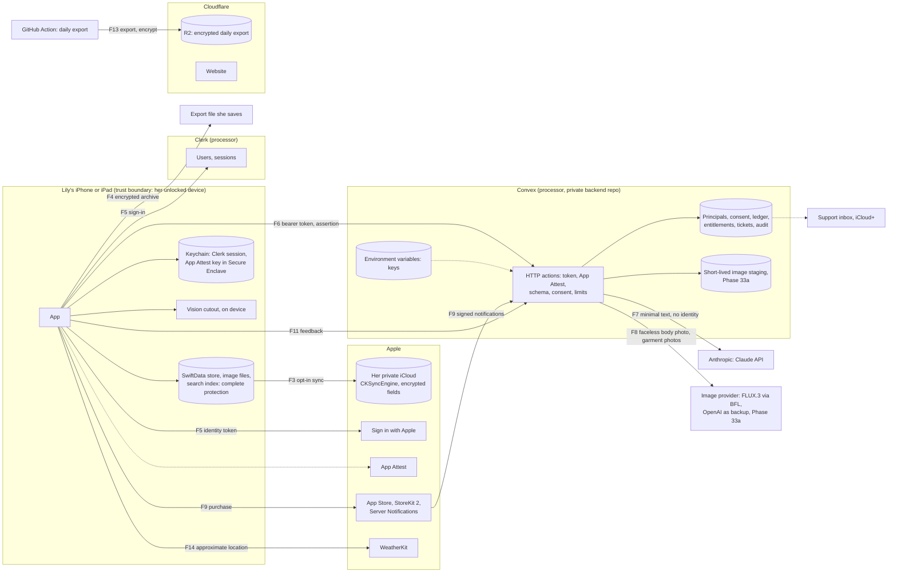

# Threat model

Phase 0c wrote the first version on 13 October 2026. **Phase 19a updated it on 18 October 2026** for real data on the stack Jose chose that day ([STACK.md](STACK.md), and the update at the top of [STAGE_B_DATA_OPTIONS.md](STAGE_B_DATA_OPTIONS.md)). It goes with [DATA_MAP.md](DATA_MAP.md) (what data exists, where it lives, who reads it and what deletes it) and [ACCOUNT_INVENTORY.md](ACCOUNT_INVENTORY.md) (the accounts that can touch the app). The controls come from [SECURITY_STANDARD.md](SECURITY_STANDARD.md) and PRD sections 9.2, 11.6, 11.7 and 15.

**Status: waiting on Jose's Phase 19a checkpoint.** Nothing has been signed up for or built. The decisions this model needs from him are listed under [Decisions for Jose](#decisions-for-jose).

The stack this model covers:

- SwiftData on the device, with `CKSyncEngine` to her private iCloud using encrypted fields
- Clerk (`clerk-ios`) for Sign in with Apple and sessions
- Convex HTTP actions as the gateway, called with plain `URLSession` and the Clerk session token as the bearer
- The Claude API (Haiku 5.5 by default, Sonnet 5.5 when quality earns it) for the stylist, and FLUX.3 through Black Forest Labs' standard API for try-on pictures (approved 19 October 2026; see D1), both called only from Convex, with keys in Convex environment variables. Apple Vision on the device masks her face before any image leaves the phone
- Cloudflare for the website, and an R2 bucket holding the daily encrypted Convex export
- App Attest, StoreKit 2 with App Store Server Notifications, and WeatherKit
- A support inbox on iCloud+ with a custom domain

The method is STRIDE (spoofing, tampering, repudiation, information disclosure, denial of service, elevation of privilege) for each data flow, plus harms that aren't attacks, such as data loss or a hurtful AI answer, because those matter as much for Lily.

Both repos are public, so this file stays at the level of a normal public threat model. It names risks and controls, not deployment names, account details, recovery methods or anything an attacker could use directly.

**Likelihood** and **impact** are High, Medium or Low, judged for a small app with one main user now and public users later. The phase column says where the control gets built and tested; see [SWIFT_BUILD_PLAN.md](SWIFT_BUILD_PLAN.md).

## Top risks, re-ranked for this stack

Ranked by what would hurt most if nothing were done, given this stack. IDs R1 to R10 are the Phase 0c risks, kept where they still apply. R11 to R15 are new.

| Rank | ID | Risk | Who it hurts | Likelihood | Impact | Main controls | Phases |
|---|---|---|---|---|---|---|---|
| 1 | R2 | Someone calls the Convex gateway outside the app (cloned app, script, stolen session, or a Convex function left public) and runs up the Claude or image provider bill | Jose | High once the gateway is live | High | App Attest on every paid request; Clerk token checked in every function; every non-HTTP Convex function `internal`; atomic ledger with cost reserved before each provider attempt; per-user, per-device and global limits; spend limit in the Claude Console; prepaid BFL credits; kill switch per feature | 24a, 24b, 25a, 30c |
| 2 | R8 | One user reads or changes another user's rows. **Convex has no row-level security**, so one missing check in one function is a leak with no database backstop | Public users | Medium once a second user exists | High | One data-access module that takes the principal ID from the verified token, never from the request; lint that fails CI on a public query or mutation outside an allowlist; cross-user tests for every function in CI | 24a, 24c, 32b |
| 3 | R5 | Her faceless body photo (on a plain studio backdrop) and her garment photos go to Black Forest Labs (FLUX.3, standard API). BFL's terms let it keep them permanently and train on them. **Jose accepted this on 19 October 2026 (D1)**, because her face, the identity, stays on the phone. The photo still shows body shape, skin and possibly tattoos or birthmarks. Other ways it goes wrong: the face mask fails and a face leaves the phone, the disclosure is missing or unclear, or a transfer URL or output URL leaks | Lily | Low that a face leaves the phone; high that BFL keeps and uses what it receives (accepted) | Medium (no face) | Phase 33a stays gated on PRD 9.2.5 (TO-03); her face and hair are masked, and the room replaced with a plain studio backdrop, on the device with Apple Vision; **if the phone can't find the face or confirm the mask, the try-on doesn't run**; plain disclosure in the try-on consent screen, the privacy policy and the App Store privacy label, with "See what was sent" showing exactly what left; separate named-recipient image permission; EXIF stripped; bytes in the request, not URLs; outputs copied to the device and staging deleted; Jose re-reads the approval before outside testers or the public launch | 19b, 22a, 33a, 33c |
| 4 | R3 | Takeover of one of Jose's accounts. The list is longer now: GitHub, Apple Developer, Convex, Clerk, the Claude Console, the image providers (Black Forest Labs, with OpenAI as backup), Cloudflare (website and backup bucket), the registrar, DNS and iCloud+ (which control the support inbox) | Lily, Jose, public users | Medium | High | Passkey or hardware-key two-factor on every one; separate dev and production deployments and keys; least-privilege tokens; a separate Cloudflare account or token for the backup bucket; account inventory with rotation dates | 23b, 25a, 25b |
| 5 | R7 | Lily loses her closet: a failed SwiftData migration, a `CKSyncEngine` merge bug, a bad restore, or a promoted CloudKit schema mistake that can't be undone | Lily | Medium | High | 20a spike gates; migrations with a recovery snapshot; merge rules as pure, tested functions; encrypted fields decided before schema promotion; sync off by default until the 21b restore test passes; encrypted export. **20b adds:** safety copies before a restore and before the first iCloud merge, with Undo for 7 days; a restore journal so a killed restore ends as the old closet or the new one; records with a newer payload version never overwritten; a device-only Keychain marker so a device restored from a backup starts sync fresh; zone deletions on other devices ask before erasing (app repo `docs/decisions/0004-backup-and-recovery.md`) | 20a, 20b, 21a, 21b |
| 6 | R4 | Text data (measurements, comfort, notes, closet descriptors) reaches Anthropic beyond what she agreed to, or is kept longer than she was told. Verified today: no training on API content, inputs and outputs deleted within 30 days, up to 2 years if flagged for a usage-policy violation, and **Haiku 5.5 may run in any geography (global, disclosed in the consent text), with US-only available as an option if needed later** | Lily | Medium | High | Named-recipient consent receipt checked on device and server; minimum context with no identity and no photos; terms recorded with URLs and dates (DATA_MAP processors); consent text says 30 days and global processing unless Jose picks a model that can be pinned to the US | 19b, 24a, 27a |
| 7 | R11 | Clerk, a third party, holds the link between her Apple ID and the app, plus her email if requested, and its data may be processed anywhere in the world. A Clerk breach, a takeover of Jose's Clerk dashboard, or a flaw in `clerk-ios` lets someone act as her | Lily, public users | Low | High | Request no name and no email scope unless Clerk requires one; ClerkKit only (no ClerkKitUI); written dependency approval with pinned version; Convex checks issuer, audience and expiry and rejects the dev instance's tokens in production; two-factor on Clerk; Clerk named in consent and privacy policy | 19b, 24a, 24c, 25a |
| 8 | R15 | Account deletion leaves data behind somewhere: Convex rows, the Clerk user, her private iCloud zone, the Apple sign-in link, provider copies, or R2 backups restored later | Lily, public users | Medium | Medium | One deletion action that walks every system in a fixed order and shows what is still pending; Apple token revocation; deletion records reapplied after any restore; backups expire in 30 days; a test that checks every table after deletion | 20b, 24c, 25b |
| 9 | R12 | The R2 backup bucket is a full copy of the Convex database: ledger, consent receipts, principal map, support tickets and reply addresses. It lives in a second provider, with its own credentials, outside Convex's access checks | Jose, public users | Low | High | Public-key encryption before upload, with the private key offline; bucket private with no public URL; a write-only token in CI; 30-day lifecycle; restore rehearsal into a test deployment; deletion records reapplied after restore | 25a, 25b |
| 10 | R6 | A secret (Claude key, image provider key, Convex deploy key, Sign in with Apple key, App Store Server API key, backup key) is committed to a public repo, printed in CI logs, or exposed to an agent session | Jose | Medium | High | No secrets in the app; push protection and gitleaks over full history; secrets only in Convex environment variables and protected CI environments; no `console.log` of env values; rotation runbook | 1b, 25a, 25b |
| 11 | R13 | Agents work on this project with tools that reach real systems: the Convex MCP server, Cloudflare connectors that can create and delete R2 buckets, and the GitHub CLI. Text an agent reads in a public repo, issue or web page could steer it, and a mistake can delete or expose data | Lily, Jose | Medium | High | Agents never get production access to Convex (the MCP server blocks it unless a flag is passed, and that flag is never used); agents work only on a dev deployment that holds no real data and uses dev keys with small caps; the env and `run` tools disabled where not needed; no agent access to the backup bucket's account; agents treat observed content as data | 23b, 25a |
| 12 | R9 | The stylist says something hurtful about her body, gives sizing as fact, or acts on instructions hidden in notes | Lily | Medium | Medium | Body-neutral policy on the server; typed response validation; user text passed as data; no tools on stylist calls; Report Styling Problem; evaluation on her saved scenarios | 27a, 28 |
| 13 | R10 | Entitlement or credit fraud: a faked purchase, a replayed notification, a refund that keeps access or credits | Jose | Medium | Medium | JWS verification of App Store Server Notifications in a Convex HTTP action; transactions checked with the App Store Server API; idempotent handlers keyed by notification and transaction ID; refund and revocation tests | 30a, 30b, 30c |
| 14 | R14 | Clerk's free plan fixes sessions at 7 days with no way to shorten or lengthen them. A stolen device session stays valid until it expires or is revoked, and Lily signs in again every week | Lily | Low | Low | Revoke sessions on sign-out and deletion; Clerk token in the Keychain with `WhenUnlockedThisDeviceOnly` (to confirm for `clerk-ios`); App Attest still required for paid calls; the local app keeps working while signed out; Pro plan if longer or shorter sessions are needed | 24a |
| 15 | R1 | Personal details about Lily are already in the public planning repo and review notes | Lily | High (already public) | Medium | **Accepted by Jose, 7 October 2026.** New docs, this one included, leave out her body and health details. The app repo, Convex and R2 never hold her real closet | Accepted |

### Retired and replaced

No Phase 0c risk retires outright. Every one still applies on this stack. Some Phase 0c **controls** are replaced:

| Phase 0c control | Replaced by | Why |
|---|---|---|
| Row Level Security with default deny "if Postgres" (R8) | A principal-scoped data-access module, `internal` functions, a CI lint and cross-user tests | Convex has no RLS. The standard's wording needs Jose's approval (decision D3) |
| Our own Sign in with Apple token check and session issuing (D1 plan, 16 October) | Clerk verifies Apple's token and runs sessions; Convex verifies Clerk's JWT | Jose chose Clerk. Moves the identity risk to a processor (R11) |
| D1 Time Travel as the backup | Daily `npx convex export`, encrypted, 30 days in R2 | Convex's scheduled backups need the paid plan (R12) |
| "Refresh token rotation" in our gateway | Clerk's session refresh | Clerk owns the session lifecycle; checked in 24a |

## Risks specific to this stack

### No RLS in Convex (R8, R2)

Convex has no database-level access rules. Every `query`, `mutation` and `action` that isn't declared `internal` can be called by anyone who knows the deployment URL, over Convex's own client protocol, not only through our HTTP actions. The app will only use HTTP actions, but that doesn't stop someone else calling a public function directly.

Controls, all in Phase 24a and 24c:

- Every function the app doesn't call by name is `internalQuery`, `internalMutation` or `internalAction`. HTTP actions are the only public entry points.
- A CI check lists every exported public function and fails if one appears outside an allowlist.
- One data-access module takes the principal ID that came from the verified Clerk token. Handlers can't query tables directly. No function accepts a user ID or principal ID from the request body as permission.
- A cross-user test for every HTTP action: user B's token against user A's ledger rows, consent receipts, tickets, cached results and reservations, expecting a rejection.
- Phase 32b repeats this at scale and the 35a independent review checks it.

**Built in 24a (21 October 2026, private backend repo, local only):** one catch-all HTTP action is the only public entry point; `principals.ts` is the one data-access module, with internal functions that take the caller from `ctx.auth`; `scripts/check-public-functions.mjs` fails on any public query, mutation or action (aliases included) and runs with the tests; a test against the local backend confirms `principals:forCaller` can't be called over Convex's client protocol. It runs as a test script for now, because the backend repo has no remote and so no CI yet. The cross-user tests cover the two 24a endpoints; 24c extends them to every table.

**Built in 24c (21 October 2026, against mocks):** `tests/authorization.test.ts` runs a second account against every endpoint in the contract (a new endpoint fails the suite until it has a case) and checks the first account's rows are unchanged and never echoed back: another account's App Attest key, challenge and Idempotency-Key, and a request naming another `usr_` ID, all fail. A contract test fails if any request schema gains a field that could name an account. Two of these also run against a real local Convex backend with signed tokens.

### Clerk holds her Apple ID link and email (R11)

When she signs in, Clerk receives Apple's identity token and stores a Clerk user with her Apple user ID and, if the scope is requested, her email (a private relay address or her real one) and name. Clerk's privacy policy (updated 15 June 2026, https://clerk.com/legal/privacy) says it acts as a processor for customer data and that data "may be transferred, processed, and stored anywhere in the world". It doesn't state how long data is kept after a user is deleted.

Controls:

- Ask Apple for no name and, if Clerk allows it, no email. The backend needs only a stable user ID (24a).
- Use the `ClerkKit` product only. It has no third-party dependencies in its target; `ClerkKitUI` pulls in Nuke and PhoneNumberKit (checked in clerk-ios `Package.swift` today). Build the sign-in button with `AuthenticationServices`.
- Pin `clerk-ios` exactly and vet it in writing before it ships (decision D2). It is MIT licensed and actively maintained (checked on GitHub today).
- Convex's Clerk provider config pins the production issuer and audience, so dev-instance tokens fail in production.
- Clerk named in the consent text and privacy policy as a processor (19b).
- Deleting her account deletes the Clerk user through Clerk's Backend API and checks whether that also revokes Apple's sign-in link (24c).
- Later, past about 50,000 users, STACK.md plans to replace Clerk with our own sign-in. That removes this processor.

### Her try-on photo and measurements going to AI providers (R4, R5)

Two different paths, kept apart on purpose:

- **Text, to Anthropic.** Minimal closet descriptors, fit facts, comfort in neutral wording, notes up to 2,000 characters and weather conditions. No name, no email, no Clerk ID, no photos. Verified today: no training on API customer content; inputs and outputs deleted within 30 days, up to 2 years for content flagged as a usage-policy violation; zero data retention only by negotiated agreement. Data at rest stays in a US workspace. Haiku 5.5 may run in any geography (global, disclosed in the consent text), with US-only inference available as an option if needed later. See DATA_MAP processors for URLs.
- **Images, to Black Forest Labs (Phase 33a only).** The model is FLUX.3, called through BFL's standard API (approved by Jose on 19 October 2026). Before anything leaves the phone, Apple Vision (person segmentation and face detection) fills her head and hair with flat grey, and the same person outline replaces the room with a plain studio backdrop, like a model photoshoot (Jose decided this on 19 October 2026, so the room never leaves the phone). What goes out is that faceless body photo on the backdrop (body shape, skin, possibly tattoos or birthmarks, in fitted clothes) and the selected garment photos. **Her face does not leave the device, and neither does her room.** If the phone can't find the face or confirm the mask, the try-on doesn't run. When the dressed body comes back, the phone aligns her real head to the neck and shoulders and blends it back in over the same backdrop, with no extra call, and Convex keeps neither the photo nor the result. **BFL's standard API Service Terms grant BFL a perpetual right to use inputs and outputs, including training, so BFL may keep these photos permanently and use them to train its models.** Jose accepted that in writing in D1, and the condition is plain disclosure: the try-on consent screen says "a photo of your body, without your face and on a plain backdrop, and your clothing photos go to Black Forest Labs, who may keep them and use them to improve their models", the privacy policy and App Store privacy label say the same, and "See what was sent" shows exactly what left. No measurements, notes or names go in the image request. Backup provider: the OpenAI image API (gpt-image-2.5 Sunburst; API data isn't used for training by default). Microsoft Azure hosting of FLUX (currently FLUX.2 pro and flex, not FLUX.3) and a BFL business agreement stay as an optional later upgrade that would remove the training exposure. WaveSpeed is used only for test and demo images of AI-generated people, never real photos. BFL's region, how it takes inputs and serves outputs, and how long delivery URLs last are **to verify in 19b**.

### Provider keys and runaway cost (R2, R6)

The Claude key, the BFL key (plus the OpenAI key for the backup), the App Store Server API key and the Sign in with Apple key sit in Convex environment variables. Anyone with production dashboard access, a production deploy key, or code that logs `process.env` can read them. Cost runs away through abuse (R2), a retry loop, or a leaked key used directly against the provider.

Controls: one key per environment and purpose; a Claude Console spend limit and alerts; prepaid BFL credits, which can't overspend (and a spend limit on the OpenAI backup key); the ledger reserves cost before each attempt and fails closed when it can't; kill switches readable without an app update; a rotation runbook rehearsed in 25b; no secrets in logs, enforced by review and a lint on `console.*` calls that touch env values. *(Phase 25a, 22 October 2026: the register is the backend repo's `docs/secrets.md`; the lint is `scripts/check-secrets.mjs`; the app repo's `scripts/check-release.sh` scans every Release build for keys, provider addresses and key files; gitleaks over all three repos' full history found no real secret. Review details are in the register.)*

### The backup bucket as a copy of the ledger (R12)

STACK.md's backup job exports the whole Convex database every day. That copy holds everything the backend holds: principal map and Clerk user IDs, consent receipts, ledger and reservations, entitlements and transaction IDs, audit events, support tickets with any reply address, and App Attest public keys. It is Personal and Account-and-billing data in a second provider, with its own credentials.

Controls (Phase 25a and 25b):

- Encrypt before upload with a public key. Only the public key is in CI; the private key stays offline with Jose. A leaked CI secret then can't read old backups.
- The job's R2 token is scoped to that one bucket and nothing else. No public bucket URL. *(Corrected 22 October 2026, Phase 25a: Cloudflare has no write-only R2 permission. Checked on its R2 token page: the narrowest is Object Read and Write on named buckets, which can also read and delete. Three controls stand in: backups are encrypted to a public key, so reading them gives nothing; a bucket lock rule keeps each object 30 days so it can't be deleted or overwritten early; and the lifecycle rule deletes after the lock ends. Confirm bucket locks in 25b.)*
- A 30-day lifecycle rule deletes old copies, matching PRD 15.4's 30-day backup rotation.
- The Convex production deploy key the export needs lives in a protected GitHub environment in the private backend repo, never in either public repo.
- The monthly restore goes into a separate test deployment, run by Jose or behind a manual approval, and the restored copy is deleted after the check.
- A restore reapplies the deletion log first, so a deleted account doesn't come back (R15).
- Whether `npx convex export` can leave out tables (such as the 24-hour result cache) is to verify in 25b.

### Clerk's 7-day session on the free plan (R14)

Verified today on https://clerk.com/pricing: the Hobby plan has a "Fixed, 7 day session lifetime". Custom session length (5 minutes to 10 years) starts on Pro at $25 a month, or $20 billed yearly. For Lily alone this means one tap to sign in again each week, and a stolen session lasts at most 7 days unless revoked sooner. How long each session **token** (the JWT Convex checks) lives is set in Clerk's JWT template and is to verify in 24a. The local closet never depends on being signed in.

### Public repos, agents and MCP access (R13, R6, R1)

Both repos are public. Anyone can read this model, the PRD and the app's source, and the Convex deployment URL and Clerk publishable key will ship in the app. Neither is a secret, so nothing may depend on them staying hidden.

Agents also work on this project. Verified today on https://docs.convex.dev/ai/convex-mcp-server: the Convex MCP server can read tables, run deployed functions, and get, set and remove environment variables; it can't reach production deployments unless started with `--dangerously-enable-production-deployments`; and `--disable-tools` can turn off tools such as `envSet`, `envRemove` and `run`. Agent sessions on Jose's machine also have Cloudflare connectors that can create and delete R2 buckets.

Controls: that production flag is never used; agents work on a dev deployment with no real data and dev provider keys with small caps; the backup bucket sits in a Cloudflare account or behind a token agents don't have; production changes go through PRs and CI in the private backend repo; agents treat text in repos, issues and web pages as data, never instructions.

## Data flows

Each flow lists its assets, the trust boundaries it crosses, the threats (STRIDE), the control and the phase that builds it.

### F1. Photo intake, EXIF stripping and cutout on the device

**Path:** system photo picker or camera → bytes in memory → size and pixel checks → downsample → strip EXIF and GPS → write original and cutout files → Vision subject lifting → cutout file and thumbnail.
**Assets:** garment photos (Personal, stored as Sensitive because a photo can show her or her room); any photo that shows her (Sensitive); location and device metadata.
**Boundaries:** Photos library to app container. Nothing leaves the device.

| Threat | STRIDE | Control | Phase |
|---|---|---|---|
| GPS and device metadata kept in stored originals, then carried into iCloud, an export or a later upload | Information disclosure | Strip metadata before the first write; test with a fixture photo that has GPS; the picker gives selected items only, so no full library access | 22a |
| A crafted or huge image crashes the app or fills the disk (decompression bomb) | Denial of service | Encoded size and decoded pixel limits before decoding; downsample through ImageIO; temporary files removed on success and failure | 22a, 22b |
| A mirror selfie or worn shot becomes a "garment" photo and later reaches a cloud route | Information disclosure | Garment photos never go on the text route; any photo route needs its own permission and moderation | 22a, 33 |
| Camera or library permission asked before it's needed | Information disclosure | Ask on first use with a clear reason string; manual entry when denied | 22a, 19b |
| Cutout quality on her iPhone 12 isn't good enough, so she works around it | Denial of service (usability) | Cutout go/no-go with `-cutout-bench` on her phone; the original always kept | 22a |

### F2. Local store and file protection

**Path:** app → SwiftData store (local only) and image files in Application Support; search index; caches; Keychain.
**Assets:** everything she enters, Sensitive included; Clerk session; App Attest key.
**Boundaries:** her device's lock state; device backups (iCloud Backup or a computer), which copy the app container.

| Threat | STRIDE | Control | Phase |
|---|---|---|---|
| A lost or stolen locked phone exposes files | Information disclosure | Data Protection `complete` on the store, images, drafts, safety copies and restore staging. The `CKSyncEngine` state is a row in the store, so no exception is needed (20a, D8(d)) | 20a, 21a, 22b |
| Someone with her unlocked phone sees measurements, try-on pictures or notes, including in the app switcher | Information disclosure | Sensitive screens hidden in the app switcher snapshot; nothing Sensitive on the general pasteboard | 14a (built), 21a, 33 |
| The Clerk session sits somewhere weaker than the Keychain | Information disclosure, spoofing | Confirm `clerk-ios` stores it in the Keychain with `WhenUnlockedThisDeviceOnly` or stricter; if it can't be set, record it in the dependency approval | 24a |
| Personal data in logs or crash reports | Information disclosure | `os.Logger` with privacy redaction; no personal data in release logs | Every phase |
| Caches, search index or recovery snapshots outlive a deletion | Information disclosure | Purge rules cover every derived copy; tests after Delete my data | 21a, 21b |
| A migration or interrupted write destroys data (R7) | Tampering, data loss | Recovery snapshot, journaled migration, 20a gates | 20a, 21a |

### F3. iCloud sync

**Path:** SwiftData store → `SyncService` (`CKSyncEngine`) → custom zone in her private CloudKit database → her other devices.
**Assets:** her whole closet, profile, looks and photos (as `CKAsset`).
**Boundaries:** device to Apple. Apple holds the keys unless she has Advanced Data Protection on; with it, encrypted fields and assets are end-to-end encrypted (Apple support page 102651, checked 16 October 2026).

| Threat | STRIDE | Control | Phase |
|---|---|---|---|
| A conflict or deletion on one device wipes or resurrects data on another | Tampering, data loss | PRD 11.7 merge rules as pure functions with table tests; deletion markers; no device-clock winner; conflict review | 20b, 21b |
| Sensitive fields readable by Apple, or by someone with her Apple Account, without ADP | Information disclosure | Every Sensitive and Personal field in `encryptedValues`; plain fields hold only IDs, revisions and timestamps; tell her what ADP adds. Accepted risk without ADP (decision D8) | 20b |
| A CloudKit schema mistake is permanent once promoted | Tampering | Promote only after 20b sign-off; encrypted fields chosen before promotion | 20b |
| Delete my data leaves her iCloud copy | Information disclosure | Delete the `Closet` and `Me` zones and wait for iCloud to confirm; show "pending" while iCloud is unreachable, run it first at the next connected launch and block turning sync on until it's done; a content-free generation marker in a `Control` zone so an offline device can't upload its old closet (0004 §6) | 20b, 21b, 24c |
| Body data in iCloud breaks App Review 5.1.3(ii) | Compliance | Measurements, weight, fit notes and the try-on photo in their own `Me` zone, not synced until Jose decides with the lawyer's answer | 20b, 21b |
| One iCloud account's closet uploads into another | Information disclosure | Store a hashed iCloud user ID with the sync state; on a switch, pause and ask (PRD 15.1) | 21b |
| Her iCloud is full and sync stalls quietly | Denial of service | Per-record pending status; clear message; local store keeps working | 20b, 21b |

### F4. Export and restore

**Path:** app → archive with the closet, photos and history → encrypted with a key from her passphrase → Files location she picks. Restore runs the other way into a staging area before replacing the live store.
**Assets:** a full copy of her data, Sensitive included.
**Boundaries:** app to wherever she saves it. Outside the app's control afterwards.

| Threat | STRIDE | Control | Phase |
|---|---|---|---|
| The archive reaches the wrong person or a shared folder | Information disclosure | Encrypted by default (AES-GCM; the passphrase key derivation chosen in 20b); preview of what's included; PRD 15.4's unencrypted archive needs Jose's written exception | 20b, 21b |
| A crafted archive escapes its folder or exhausts the disk on restore (path traversal, archive bomb) | Tampering, denial of service | Validate entries, sizes and counts before writing; restore into staging, verify hashes, then swap. 20b's limits: regular files and folders only, no absolute paths or `..`, at most 200,000 entries, sizes matching the manifest, total under free space | 21b |
| She forgets the passphrase | Denial of service (her own data) | Said plainly before saving; a generated passphrase offered; Check a copy to try it before it's needed. No recovery by design | 21b |
| A restore brings back data she deleted, or an old schema breaks the store | Tampering, data loss | Restore respects deletion markers; schema version checked; old store kept until the restore verifies | 21b |

### F5. Sign-in through Clerk

**Path:** Sign in with Apple sheet (`AuthenticationServices`) → Apple identity token → `clerk-ios` → Clerk's Frontend API → Clerk user and session → session token in the Keychain.
**Assets:** Apple user ID, optional email and name, Clerk user ID, session.
**Boundaries:** device to Apple; device to Clerk (a third-party processor, global processing).

| Threat | STRIDE | Control | Phase |
|---|---|---|---|
| Clerk breach or a takeover of Jose's Clerk dashboard exposes her Apple link and email, or lets someone act as her (R11) | Spoofing, information disclosure | Minimal scopes; two-factor on Clerk; production and dev instances separate; any dashboard feature that can act as a user stays off; Clerk in the account inventory | 24a, 25a |
| A flaw or malicious update in `clerk-ios` | Tampering | ClerkKit only, exact pin, written approval, Dependabot, review of each update | 24a |
| A dev-instance token or a token for another app accepted in production | Spoofing | Convex checks issuer, audience and expiry against the production instance only; a test sends a dev token. **24a:** `auth.config.ts` names one issuer (`CLERK_JWT_ISSUER_DOMAIN`) and audience `convex`; against a real local Convex backend, tokens from another issuer, for another audience, expired or wrongly signed all get 401. The production check itself waits for a production deployment | 24a |
| A stolen session is replayed | Spoofing | 7-day ceiling (R14); revocation on sign-out and deletion; App Attest still required for paid calls | 24a |
| Sign-in fails or Clerk is down | Denial of service | Local closet unaffected; cloud features show "signed out"; retry is her choice | 24a, 26 |

### F6. App to Convex with App Attest

**Path:** app → `URLSession` over TLS → Convex HTTP action with `Authorization: Bearer <Clerk token>` and an App Attest assertion over the request → verify token, assertion, schema, consent, entitlement, limits → internal mutation or action.
**Assets:** request bodies (Sensitive when they carry fit facts or comfort), principal ID, attestation keys and counters.
**Boundaries:** device to Convex (public internet); HTTP action to internal functions.

| Threat | STRIDE | Control | Phase |
|---|---|---|---|
| Scripted or cloned clients call paid endpoints (R2) | Spoofing, denial of service | Attestation registered once per key against a server challenge; an assertion per paid request with a checked, increasing counter stored in a mutation; a bounded fallback for devices that can't attest, with no paid access. **24b:** built except Apple's attestation check. Challenges are one-time, 5 minutes, rate limited (10 an hour); each assertion signs the method, path, Idempotency-Key and a hash of the exact body, is verified with WebCrypto in the HTTP action, and its counter is compared and stored in the admission mutation; keys belong to one account and to the mode they were registered in. Registration works only in the `mock` mode (local and dev); the `apple` mode fails closed until the certificate-chain check is built and tested with a real device (app decision 0006, device checklist). Devices that can't attest get no paid access; no fallback is built | 24a, 24b |
| Someone calls a public Convex query or mutation directly, skipping the HTTP action checks (R8, R2) | Elevation of privilege | Everything except HTTP actions is `internal`; CI lint; cross-user tests | 24a, 24c |
| Client-supplied IDs used as permission | Elevation of privilege | Principal taken only from the verified token | 24c |
| Oversized or malformed requests | Denial of service, tampering | Typed schema, 64 KiB body, 2,000-character notes, unknown fields rejected. **24a:** built from the shared contract's schemas, checked after the token and before any parsing is trusted; tested on both sides with the contract's invalid examples | 24a |
| Raw request bodies in Convex function logs | Information disclosure | No payload logging; log only action IDs, error categories, cost and latency (**24a:** request ID, route, method, status and timing only; token errors are never logged). How long Convex keeps function logs is still to verify, on a cloud deployment | 24a |
| An admin or config change can't be traced | Repudiation | Audit table for sign-ins, attestation failures, entitlement, credit, price, model and budget changes, without personal data | 24a, 25b |
| Dev and production mix | Information disclosure | Separate Convex deployments, Clerk instances and provider keys per environment | 23b, 25a |

### F7. Convex to Claude

**Path:** internal action → build minimal context (descriptors, fit facts, neutral comfort, notes, conditions) → Claude Messages API over TLS with the key from an environment variable → validate the typed response → store the normalized result in a 24-hour encrypted cache → return to the app.
**Assets:** Sensitive request content, the Claude key, the response.
**Boundaries:** Convex to Anthropic (a processor; US workspace storage; inference in any geography by default).

| Threat | STRIDE | Control | Phase |
|---|---|---|---|
| Anthropic keeps the content longer than she was told, or processes it outside the US (R4) | Information disclosure | Consent text states the verified terms: no training, 30 days, up to 2 years if flagged, global inference on Haiku 5.5 (disclosed in the consent text), with US-only available as an option if needed later; recheck on any model change | 19b, 27a |
| Identity or more context than needed in the prompt | Information disclosure | Builder takes only allowlisted fields; no name, email, Clerk ID or principal ID; no photos (the text route rejects images). **Built 27a (against a fake):** the app's `APIV1.StylistPiece` is the one place a garment becomes sendable (no notes, brands, sizes, wear dates, measurements or weight; a test checks the keys); the contract rejects unknown fields; on the server garment IDs become aliases and no account, request or garment ID reaches the provider (tested on the request body) | 27a |
| Prompt injection through garment notes or names | Tampering | Notes passed as data; no tools on stylist calls; response validated against product rules. **Built 27a:** garment notes aren't sent at all; names, other names, an occasion's words and questions are cleaned (control and invisible characters removed, angle brackets replaced so a name can't close its `<closet>` or `<request>` block), quoted, capped, and placed after the policy, which says they are data; structured JSON output; a test feeds a name that tries to close the block and give orders | 27a |
| A hurtful or invalid answer (R9) | Tampering | Body-neutral policy on the server; schema and rule validation; Report Styling Problem. **Built 27a:** every look may use only pieces from the request (an invented one drops the version), the outfit rules and `ResultCheck`'s rules are enforced on the server and again on the phone, a why line that talks about her body is dropped, a missing version must be shown impossible or the attempt didn't finish, and nothing unvalidated reaches the app. Report Styling Problem isn't built | 27a, 28 |
| Cost runaway from retries or long outputs (R2) | Denial of service (cost) | Cost reserved before each attempt; at most 2 attempts; token caps; Console spend limit | 24b, 27b |
| A delayed result lands after she withdrew consent or deleted her account | Information disclosure | Recheck consent and deletion version before caching or returning. **Built 27a:** a deleted account's result is neither kept nor returned (24c settle, stylist results purged with the account); consent is checked on the phone before anything is sent and by version on the server before admission. A withdrawal doesn't reach the server's 24-hour result rows yet; they expire on their own | 24c, 27a |
| Outage or price change | Denial of service | Kill switch; honest error state; on-device model on eligible phones (not her iPhone 12) | 26, 28 |
| The 24-hour result cache leaks what she asked, or serves one account's answer to another (27a) | Information disclosure | Results sealed with AES-256-GCM under `NOOK_RESULT_KEY`, bound to the account and the cache key; the cache key is an HMAC, never the request; reads are scoped to the caller's principal (tested across two accounts); 24 hours, then a daily cron; without the key the stylist stays paused | 27a |
| Her consent is to one provider and the server switches to another (PRD 11.3) | Information disclosure | The request names the consent text's version; the server sends only to a provider that version covers (`CONSENT_COVERS`), otherwise `consent_required` before anything is counted (tested) | 27a |

### F8. Convex to the image provider (Phase 33a only)

**Path:** on the phone, Apple Vision masks her head and hair with flat grey and replaces the room with a plain studio backdrop (if the face isn't found or the mask can't be confirmed, the job stops here) and EXIF is stripped → app → HTTP action with the faceless body photo on the backdrop and the selected garment photos → short-lived Convex staging → BFL's standard API (FLUX.3; OpenAI as backup) with the key from an environment variable, sent as bytes → dressed body picture → Convex hands it to the app and deletes staging → the phone aligns her real head to the neck and shoulders, blends it back in over the same backdrop, and stores the finished picture on the device and her iCloud if on.
**Assets:** the faceless body photo on a studio backdrop and her garment photos (her face and her room stay on the phone), the dressed picture, the BFL key.
**Boundaries:** device to Convex; Convex to BFL (standard API terms: BFL may keep inputs and outputs permanently and train on them, accepted in D1; region and how it takes inputs and serves outputs to verify in 19b).

| Threat | STRIDE | Control | Phase |
|---|---|---|---|
| BFL keeps her photo and trains on it, or passes it on (R5) | Information disclosure | **Accepted by Jose in D1 (19 October 2026), on condition of plain disclosure:** the try-on consent screen, the privacy policy and the App Store privacy label say BFL may keep the photos and use them to improve its models, and "See what was sent" shows exactly what left; her face is masked on the device, so the photo has no face; named-recipient image permission; Jose re-reads the approval before outside testers or the public launch; Azure or a BFL business agreement is the optional upgrade | 19b, 33a, 33c |
| The face mask fails and a face leaves the phone (matters more now that BFL may keep and train on what it receives) | Information disclosure | Mask on the device before upload with a person-segmentation and face-detection check; **fail closed:** if no face is found or the mask can't be confirmed, the job doesn't run; the server never receives the unmasked photo; test on a range of photos (hair, poses, hats, scarves, coats) in 33a | 33a |
| A transfer or output URL is readable by anyone who has it | Information disclosure | Send bytes in the request, not a URL; if a URL is needed, short expiry and deletion right after the job; outputs copied to the device, never linked; how the provider takes inputs and serves outputs is to verify in 33a | 33a |
| Measurements or notes added to the image prompt | Information disclosure | Image prompt built on the server from garment descriptors only | 33 |
| Someone uploads a photo of another person, or the output is unsafe | Spoofing, information disclosure | Input and output moderation; her own reference photo only; TO-03 | 33a |
| Image cost runs away (R2) | Denial of service (cost) | PRD 9.2.4 bounds: 2 attempts per child, 3 children, one active job; reserved before each attempt; prepaid BFL credits | 24b, 33a |
| Late output after withdrawal or deletion | Information disclosure | Deletion and consent fences; staging cleanup job | 33a |

### F9. StoreKit and App Store Server Notifications

**Path:** app → StoreKit 2 purchase with an `appAccountToken` set to her principal's UUID → Apple; Apple → App Store Server Notifications V2 → public Convex HTTP action → JWS verification → idempotent internal mutation updates entitlements and credits.
**Assets:** transaction IDs, entitlements, credit balances.
**Boundaries:** device to Apple; Apple to Convex (a public endpoint anyone can POST to).

| Threat | STRIDE | Control | Phase |
|---|---|---|---|
| Forged or replayed notification (R10) | Spoofing, tampering | Verify the JWS `x5c` chain to Apple Root CA G3 and the signature; check bundle ID and environment; unique notification UUID | 30c |
| Client claims an entitlement or balance it doesn't have | Elevation of privilege | Server is the authority; transactions checked with the App Store Server API; the app only displays state | 30c |
| `appAccountToken` swapped to credit someone else | Tampering | Link a transaction to a principal only through verified transaction data and the signed-in principal; never trust the token alone | 30c |
| Refund or revocation keeps access or credits | Elevation of privilege | Refund, revoke and expiry handlers with tests | 30c |
| Flood of junk POSTs | Denial of service | Reject before any database write when the signature fails; size limit | 30c |

### F10. Credit ledger and reservations

**Path:** HTTP action → internal mutation reserves the worst-case cost against principal, provider and global budgets → internal action calls the provider → internal mutation settles the actual cost or keeps the reservation when the outcome is unclear → scheduled reconciliation.
**Assets:** ledger rows, reservations, budgets, kill switches.
**Boundaries:** inside Convex. Mutations are serializable transactions; actions aren't transactional.

| Threat | STRIDE | Control | Phase |
|---|---|---|---|
| Two requests race past a limit | Tampering | Reserve in one mutation; settled cost plus open reservations decide admission. **24b: built** (`ledger.admit`): the switches, a 5-a-minute token bucket, one running paid action per account, rolling 24-hour and 30-day allowances, US$1 per account per 30 days and the provider and global daily and monthly ceilings, all in one serializable mutation with the reservation. Tested in `convex-test` and on a real local Convex backend | 24b |
| A crash after the provider call loses the charge | Repudiation, denial of service (cost) | Reservation kept until reconciliation; missing usage is never treated as zero. **24b: built**: an uncertain or crashed attempt (a running action past its 60-second lease) keeps its reservation and its allowance slot, and its key answers `action_in_progress` instead of running again. Reconciliation itself needs the real providers' usage (27a, 33a) | 24b |
| A retried request or replayed notification spends or grants twice | Tampering | Idempotency keys kept at least 24 hours; same key with different content rejected. **24b: built** for paid requests: the key is bound to a hash of the endpoint and body; a repeat returns the first answer without running or counting; a different body is `idempotency_conflict`. A definite failure gives the reservation back and allows one more attempt with the same key, with its own reservation (at most 2) | 24b, 30c |
| Ledger or pricing config unavailable | Denial of service | Fail closed for paid work; local features keep running. **24b: built**: a missing switch is off and a missing or invalid ceiling stops paid work, so a fresh deployment pauses every paid feature until Jose sets them; `NOOK_KILL_SWITCH=on` stops everything without the database | 24b, 26 |
| A bug or abuser runs up one provider's bill | Denial of service (cost) | **24b:** per-provider and global daily and monthly ceilings in `spendControls`, changed only with `npx convex run` and logged in `controlChanges`; alerts recorded once at 50, 75, 90 and 100 per cent (delivery is a stub until 25a); try-on falls back to the backup provider only with its own reservation. Vendor-side limits (the Claude Console spend limit, prepaid BFL credits) are still needed (25a) | 24b, 25a |
| Deleting data resets her allowance | Elevation of privilege | Minimal pseudonymous usage-window state survives deletion, disclosed in the policy. **24c: built**: `retainedUsage` keeps each counted use's category and time for 31 days under an HMAC of the token identifier, and a new account with the same key starts with them. **Gap:** Clerk issues a new user ID after a deletion, so in production the hash only matches if the `convex` JWT template carries an identity that survives deletion (Apple's own `sub`): decision D13 | 24b, 24c |

### F11. Feedback and support

**Path:** Send feedback drawer → she sees every value that goes → HTTP action (signed in, no App Attest, rate limited) → `supportTickets` in Convex (screenshot in file storage) → Jose reads it in the dashboard or with `npx convex run support:...` and replies from the iCloud+ support inbox if she gave a reply address. **24d built against mocks (22 October 2026).** Signed out, Send hands the text to the system share sheet.
**Assets:** free text (she may write anything), optional reply address, optional app and device details.
**Boundaries:** device to Convex; Jose's email to hers.

| Threat | STRIDE | Control | Phase |
|---|---|---|---|
| Closet data, photos or measurements attached without her meaning to | Information disclosure | Nothing attached automatically; the page lists every value, a test checks the request carries only those, the contract rejects any other field (a device name, a list of pieces, an account ID). Closet size is three numbers behind its own switch; the screenshot is one she chooses and sees | 14b (built), 24d (built) |
| A screenshot or photo leaks her location, time or device | Information disclosure | Rewritten from pixels on the phone, and again on the server from the file's structure (JPEG and PNG only; EXIF, XMP, IPTC, thumbnails, text chunks dropped; other formats refused); tests with planted metadata, on the phone, in the fake server's audit, on the backend and on a real local Convex backend | 24d (built) |
| A crafted image or oversized body burdens the backend | Denial of service | 600 KB and 8,192 px caps checked from the header, nothing decoded; 1 MiB body for this endpoint only; a refused picture leaves no ticket or file | 24d (built) |
| Another account reads or changes her ticket | Elevation of privilege | No function reads tickets for a client; admin reads are internal functions; the request names no account; cross-user case in the authorization test; attaching to or discarding another's pending ticket matches nothing | 24d (built) |
| Someone spoofs the support address to phish her or users | Spoofing | Add the DMARC record still missing (STACK.md), then move it toward `p=reject` | 24d |
| Takeover of the iCloud account, registrar or DNS that control the inbox (R3) | Spoofing, information disclosure | Two-factor on all three; listed in the account inventory | 24d, 25a |
| Floods fill the table | Denial of service | Per account: burst 5 then one every 12 minutes, 10 notes and 3 screenshots a day; 300 notes a day across accounts; `NOOK_SUPPORT_INTAKE=closed` closes intake without an app update; tested | 24b, 24d (built) |
| Tickets kept longer than promised, including in backups | Information disclosure | Daily cron: 90 days after closing, 180 days if never closed, row and file; deleted with the account; backups age out 30 days later (R12) | 24d (built), 25b |

### F12. Account deletion

**Path:** Delete my data or Delete account in the app → local purge and iCloud zone deletion on the device → HTTP action → internal mutation deletes her principal's rows and writes a deletion record → Clerk Backend API deletes the Clerk user → Sign in with Apple token revoked → app shows each step as done or pending. Provider copies age out on their own terms; backups age out in 30 days.
**Assets:** all of her data in every system.
**Boundaries:** device, Apple (iCloud and Sign in with Apple), Convex, Clerk, Anthropic and BFL (no deletion call; BFL may keep what it received), R2.

| Threat | STRIDE | Control | Phase |
|---|---|---|---|
| A table or system is missed (R15) | Information disclosure | A deletion test seeds every table and system and checks each is empty after; new tables must join the test. **24c: built**: `tests/deletion.test.ts` lists every table as deleted, never naming an account, or kept on purpose, fails on a table it doesn't list, and checks no row still carries the account's principal, `usr_` ID, Clerk subject or key ID. On the app, the UI test and the checkpoint check the store, photos and preferences are empty after | 24c |
| Apple's sign-in link stays active | Information disclosure | Revoke through Apple's REST endpoint, or confirm Clerk does it when the user is deleted (open question in STAGE_B_DATA_OPTIONS.md). **24c:** the app gets a fresh authorization code by asking Apple again (also the re-authentication) and sends it once; the backend's revocation is a mock, the real call isn't built (needs the Sign in with Apple key). If it fails she's told how to remove the link in Settings | 24c |
| A backup restore brings her data back | Information disclosure | Deletion records kept (pseudonymous ID and date only) and reapplied after every restore. **24c: built**: records kept 35 days; `deletion:reapplyAfterRestore` takes the live table's records (exported before the restore) and deletes any account that came back; tested | 24c, 25b |
| Deletion is mistaken for cancelling the subscription | Repudiation | The note that deleting doesn't cancel billing, plus a Manage Subscription link. **24c:** the note is on the screen. **30a:** the note and a Manage subscription link show only while a subscription may still bill her, read from StoreKit on the phone | 24c, 30 |
| Someone else deletes her account | Tampering | Signed in, attested, with confirmation; no support call needed. **24c:** signed in, confirmed, and Apple asks again; the request can't name another account. App Attest is **not** required, on purpose: devices that can't attest must still be able to delete (Guideline 5.1.1(v)). The re-authentication is the stronger check | 24c |
| An in-flight AI job writes a result after deletion | Information disclosure | Deletion version checked before any write. **24c: built** for the placeholder paid path: the account is marked first, admission refuses it, cost entries are deleted before actions, and `ledger.settle` drops a result whose entry is gone. 27a and 33 must keep this when results are stored | 24c, 27a, 33 |
| A sign-in re-creates the account between the purge and the Clerk deletion | Tampering | **24c: found by the local-backend test and fixed**: while a deletion runs, `POST /v1/session` and every other endpoint answer `forbidden`, even after the principal row is gone | 24c |
| A deletion stops part-way (Clerk down, a timeout) | Information disclosure | **24c: built**: every step repeats safely; the scheduler retries (30 seconds, doubling, 8 tries) and then alerts `deletion_stuck`; the app can repeat the request; the status endpoint needs no token, by a random `del_` ID | 24c |

### F13. Backups to R2

**Path:** scheduled GitHub Action in the private backend repo → `npx convex export` with a production deploy key → encrypt with a public key → upload to a private R2 bucket → 30-day lifecycle; monthly restore into a test deployment.
**Assets:** a full copy of Convex (R12); the deploy key; the backup key.
**Boundaries:** Convex to GitHub runners; GitHub to Cloudflare.

| Threat | STRIDE | Control | Phase |
|---|---|---|---|
| The bucket or a backup file becomes readable | Information disclosure | Encrypted before upload; private key offline; no public URL; R2 also encrypts at rest with AES-256 (verified today) | 25b |
| The production deploy key leaks from CI | Elevation of privilege | Protected environment with required approval for anything but the export; key rotated on a schedule; never in a public repo | 25a |
| An agent, a mistake or an attacker deletes the bucket, so backups vanish quietly | Denial of service, tampering | Bucket in an account or behind a token agents don't hold; a failed or missing daily upload alerts Jose; bucket lock if R2 offers it, to verify in 25b | 25b, 31 |
| Restores never tested | Denial of service | Monthly restore rehearsal with a recorded result | 25b |
| A restore resurrects deleted accounts | Information disclosure | Deletion log reapplied first | 25b |

### F14. Weather and location

**Path:** app asks for approximate, while-in-use location → WeatherKit framework on the device → forecast → conditions (not coordinates) go into a styling request.
**Assets:** her approximate location (Sensitive); the forecast (Public).
**Boundaries:** device to Apple. Convex never sees coordinates.

| Threat | STRIDE | Control | Phase |
|---|---|---|---|
| Precise location requested, stored or sent beyond WeatherKit | Information disclosure | Approximate, while-in-use only; no storage of coordinates; conditions only in AI requests | 29 |
| Quota exhausted by retries | Denial of service | 30-minute snapshot, coalesced lookups, one retry, manual fallback | 29 |

## Other components

These carry over from Phase 0c with small updates.

### Analytics and crash reports

| Threat | STRIDE | Likelihood | Impact | Control | Phases |
|---|---|---|---|---|---|
| Analytics joined to billing or wardrobe records | Information disclosure | Low | Medium | Off by default, allowlisted events, resettable ID never joined, 30-day raw retention. No third-party SDK without written approval | 31 |
| Crash reports carry user content | Information disclosure | Low | Medium | Xcode Organizer only unless Phase 31 approves something else; no user content in logs | 18, 31 |
| Public board spam or personal data in posts | Tampering, information disclosure | Medium | Medium | Moderation before anything is public; or a written decision in 24d to leave the board for later | 24d |

### Repos, CI and supply chain

| Threat | STRIDE | Likelihood | Impact | Control | Phases |
|---|---|---|---|---|---|
| Direct or force push slips in bad code | Tampering | Medium | High | Rulesets, required CI, signed commits, admins included (built in 1b). The private backend repo needs the same | 1b, 23b |
| A compromised Action or package steals tokens | Tampering | Low | High | SHA-pinned Actions, read-only token, exact pins, written approval per dependency (`clerk-ios` included), Dependabot. npm packages in the backend repo need a lockfile and the same review | 1b, 24a |
| Prompts or fit rules leak into the public app repo | Information disclosure | Medium | Medium | Rules only in the private backend repo; CODEOWNERS and PR checklist | 1b, 27a |
| Real photos of Lily in fixtures or snapshots | Information disclosure | Low | High | Synthetic fixtures only; the AI-generated sample wardrobe shows stand-in people, not her | 3, 22a |

### Website and review site

| Threat | STRIDE | Likelihood | Impact | Control | Phases |
|---|---|---|---|---|---|
| Website defaced through a Cloudflare takeover | Tampering | Low | Medium | Two-factor; scoped tokens; static site with a strict CSP | 19b |
| Lookalike site or app phishes users | Spoofing | Low | Low | Store listing and website link to each other | 35b |
| Anyone with the review link reads or spams Lily's notes | Information disclosure, tampering | Medium | Low | Link shared only with Lily; retire or freeze the site after review | Now |

## Decisions for Jose

Each needs his choice, or his written approval in the progress log with a reason and a review date (standard, top).

| # | Decision | Options and our suggestion | Needed by |
|---|---|---|---|
| D1 | Try-on provider and what leaves the phone | **Decided and approved by Jose, 19 October 2026.** FLUX.3 through BFL's standard API is approved for real photos because her face never leaves the phone. Apple Vision fills her head and hair with flat grey on the device, and the same outline replaces the room with a plain studio backdrop like a model photoshoot, so only a faceless body photo on that backdrop and the garment photos go out; her real head is blended back on the phone over the same backdrop (Phase 33a). The room never leaves the phone. **Jose accepts in writing that BFL may keep these photos permanently and use them to train its models** (BFL's standard API terms grant that right). That covers body shape, skin, possible tattoos or birthmarks in fitted clothes, on a plain backdrop, and the clothing photos. Lily sees these facts in the consent screen and agrees to them there. His reason: "the face is the identity, and it stays on the phone." **Condition:** plain disclosure in the try-on consent screen ("a photo of your body, without your face and on a plain backdrop, and your clothing photos go to Black Forest Labs, who may keep them and use them to improve their models"), in the privacy policy and in the App Store privacy label, and "See what was sent" shows exactly what left. If the phone can't find the face or confirm the mask, the try-on doesn't run. **Review point:** before any outside testers or the public launch, Jose re-reads this approval. No BFL business agreement or Azure is needed now; both stay as an optional later upgrade. Backup: OpenAI gpt-image-2.5 Sunburst (no training on API data by default). WaveSpeed and Google Vertex are out for real photos | Done; review before outside testers |
| D2 | `clerk-ios` as a shipping dependency | **Approved by Jose as suggested, 19 October 2026.** Approve `ClerkKit` only, pinned exactly, after vetting its Keychain settings and what `Package.resolved` pulls in. The alternative is our own Sign in with Apple through `AuthenticationServices` with a Convex-issued token, which adds no dependency but more code to secure | Before 24a |
| D3 | RLS wording in SECURITY_STANDARD.md section 5 | **Approved by Jose as suggested, 19 October 2026.** Suggested text: "Authorization on every request. If the database supports row-level security, it is on for every table with default deny. If it doesn't (Convex, D1), every public entry point checks the signed-in user, all other functions are internal, data access goes through one module that takes the principal from the verified token, and CI proves one user can't read another's data." Approve it as the rule, so it isn't read as an exception | Before 24a |
| D4 | Clerk's fixed 7-day session (R14) | **Approved by Jose as suggested, 19 October 2026.** Accept on the free plan for Lily alone; revisit Pro ($25 a month) before outside testers | Before 24a |
| D5 | Where her text requests are processed (R4) | **Approved by Jose as suggested, 19 October 2026.** Updated by Jose, 20 October 2026: the default model is Haiku 5.5, and global processing is allowed (disclosed in the consent text), because the app may expand beyond the US later. US-only inference (`inference_geo: "us"`, 1.1 times the price) is an option to keep in mind, not a requirement. Phase 27a notes whether Haiku 5.5 supports it. 27a (21 October 2026): the model is server configuration (`NOOK_STYLIST_MODEL`, default `claude-haiku-5-5`); global by default; `NOOK_STYLIST_GEO=us` turns on US-only inference. Anthropic's data-residency page gives `inference_geo` to Claude 4.6 and later models, which includes Haiku 5.5; the first real response's `usage.inference_geo` confirms it. | Before 27a |
| D6 | What Clerk keeps about her | **Approved by Jose as suggested, 19 October 2026.** Request no name and no email from Apple unless Clerk requires an identifier; if it does, accept the private relay address | Before 24a |
| D7 | Backup design (R12) | **Approved by Jose as suggested, 19 October 2026.** Public-key encryption with the private key offline; restore test run by Jose or behind manual approval; the backup bucket in a Cloudflare account or token separate from the website and from agents. This covers server backups only; on-device backups, export and iCloud were designed in Phase 20b (app repo `docs/decisions/0004-backup-and-recovery.md`, waiting on Jose) | Before 25b |
| D8 | Risks to accept in writing | **Approved by Jose, 19 October 2026:** (a), (b), (c), (e) and (f) accepted, reviewed again before outside testers; (d) is decided in Phase 20a when the spike shows whether the exception is needed. (a) Without ADP, Apple can read her synced data; (b) Anthropic keeps request content up to 30 days, longer if flagged, with no zero-retention agreement; (c) Clerk and possibly Black Forest Labs process data outside the US; (d) a possible Data Protection exception for the `CKSyncEngine` state file (20a); (e) R1 stays accepted; (f) faceless body photos and garment photos may be used by BFL for training (already accepted by Jose in D1, 19 October 2026, on condition of disclosure; review before outside testers) | At this checkpoint, or at the phase named |
| D9 | Agent access to Convex and Cloudflare (R13) | **Approved by Jose as policy, 19 October 2026.** Adopt as policy: agents never use the Convex MCP production flag, get no production deploy key, and have no access to the backup bucket | At this checkpoint |
| D10 | Export format (carried from Phase 0c) | **Approved by Jose as suggested, 19 October 2026.** Encrypted, as the standard requires, unless he approves PRD 15.4's unencrypted archive in writing | 20b |
| D11 | Clerk's Keychain accessibility (24a) | **Open.** `clerk-ios` 1.6.1 stores the session with `kSecAttrAccessibleAfterFirstUnlockThisDeviceOnly`, and the SDK has no option to change it. SECURITY_STANDARD §4 asks for `WhenUnlockedThisDeviceOnly` or stricter. Options: (a) a written exception with a review date, since the session is still device-only and never in backups; (b) ask Clerk for the option and wait; (c) D2's alternative, our own Sign in with Apple with a Convex-issued token. Suggested: (a), reviewed before outside testers. Nothing is affected until a Clerk key is configured | Before the Clerk switch |
| D12 | Production limits and ceilings (24b) | **Open.** The backend enforces PRD 11.6's proposed allowances (10 outfit ideas and 40 swaps or questions a day, 5 AI actions a minute, US$1 per account per 30 days) and placeholder try-on numbers (3 a day, 30 a month). Dev ceilings are seeded (global US$10 a day and US$100 a month; Anthropic and BFL US$5 and US$50; OpenAI US$2 and US$20). Production values, Lily's owner-sponsored policy, and the real image prices (the backend uses a US$0.10 placeholder per picture) need Jose's approval before outside testers | Before 25a, and 33a for images |
| D13 | Keeping allowances across an account deletion (24c) | **Open.** The backend keeps a deleted account's recent use under a keyed hash of its sign-in identity, but Clerk gives a new user ID after a deletion, so the hash won't match. Options: add Apple's own user ID (`sub`, stable per developer team) to the `convex` JWT template and hash that instead; accept that deleting resets allowances (the US$1 per account and global ceilings still cap cost); or tie it to the device's App Attest key. Suggested: Apple's `sub`, if Clerk's template can carry it |
| D14 | The cloud stylist's open choices (27a) | **Open.** (a) Whether measurements and weight ever go to Anthropic: 27a sends neither and uses consent version A; (b) labelled ideas for an empty closet (PRD 8.1): still Add a piece; (c) a version the stylist left out that the server can't show is impossible counts as "didn't finish" (PRD 8.1), so she gets no partial look in that case; (d) Anthropic's prompt cache TTL, 5 minutes by default (1 hour costs twice the write); (e) the official Anthropic SDK as a backend dependency (27a calls the API over `fetch`) | Before outside testers |

## To verify, and gaps in the plan

**To verify in 19b (provider terms, recorded in DATA_MAP processors):** for BFL: processing region, how it takes inputs and serves outputs, the retention period of outputs and delivery URLs, sub-processors and whether it deletes on request (training use is already accepted in D1); the same questions for OpenAI as backup; Clerk's retention after a user is deleted and its sub-processor list; Convex's hosting region for our deployments, encryption at rest and function-log retention; whether Anthropic offers zero data retention to an account this size.

**To verify in the build phases:** Clerk session token lifetime with the `convex` template, once the instance exists (24a, carried); `clerk-ios` 1.6.1's Keychain accessibility was checked in 24a: `AfterFirstUnlockThisDeviceOnly`, not configurable, so D11 below; whether deleting a Clerk user revokes Apple's sign-in link (24c); how BFL takes input images and serves outputs, and whether a public URL is involved (33a); whether `npx convex export` can leave out tables, and whether R2 offers a bucket lock (25b).

**Gaps:** 24b left these for later phases: a scheduled clean-up of ledger rows older than 31 days and used challenges (25b), alert delivery (25a), reconciliation of uncertain provider attempts (27a, 33a), Apple's attestation check (device checklist in app decision 0006), and a bounded fallback for devices that can't attest. No Stage B phase bullet builds the daily backup job; STAGE_B_DATA_OPTIONS.md puts it in 25b, so 25b needs a bullet. The lint for public Convex functions (R8) was built in 24a as a backend test script; it moves into CI when the backend repo gets one. DMARC for the support domain is still missing (STACK.md).

## What this model does not cover yet

- Find One (Phase 34) and try-on (Phase 33a) in full. Each gets its own model before it is enabled; F8 is the starting point for Phase 33a.
- Legal risk (state health-data laws, GDPR, processing outside the US). That goes to the lawyer in 19b and 35a.
- The on-device stylist (Phase 28) adds no new data flow, so it isn't modelled separately.
